---
layout: default
title: "VPN GitHub Comparison 2026 - Free VPN Safety, Windows Apps & Speed Tests"
description: "Found a free VPN, APK, config, or proxy list on GitHub? Compare safer Windows options, understand server-owner risk, and see when a maintained paid VPN is worth it."
---

# VPN GitHub Comparison 2026 - Free VPN Safety, Windows Apps & Speed Tests
**Last updated:** November 20, 2026 - VPN Universe

VPN Universe is built for someone who searched **VPN GitHub**, **free VPN GitHub**, or **free VPN for Windows** and now has to decide whether the result is software, a server list, or a trustworthy service. Public source code can be inspected; it does not prove who operates a free server, what that server records, or whether an APK matches the published code. This page separates those questions before comparing paid alternatives for streaming, travel, public Wi-Fi, and everyday Windows use.

## Daily speed evidence

The chart is useful because all four providers are followed under the same project. It is not a promise that your ISP, city, server, or protocol will produce the same number. Read trends, not one lucky peak.

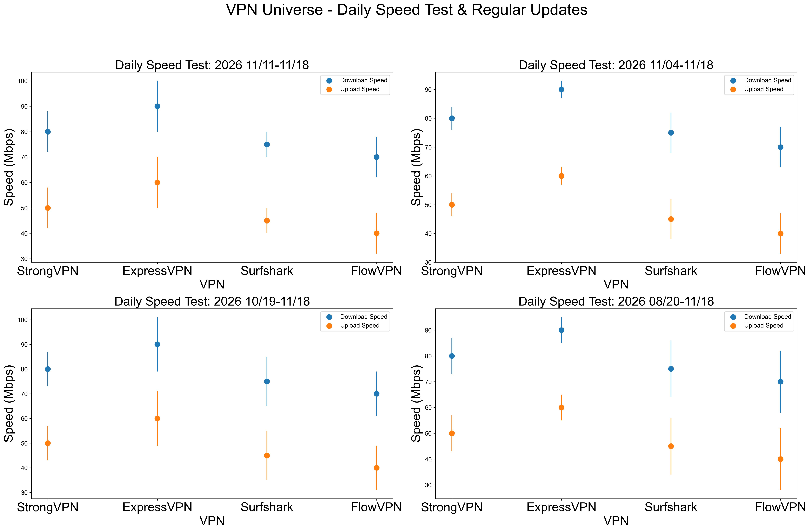

StrongVPN does not need to win the speed chart to remain first. It needs enough sustained performance for the target use while keeping the one-year cost lower. ExpressVPN is the premium fallback; Surfshark is the multi-device choice; FlowVPN is the short test.

## First identify what the GitHub result actually is

| GitHub result | What it proves | What it does not prove | Safe next step |
|---|---|---|---|
| Open-source VPN client | The client code and development history can be inspected | The server operator is trustworthy or streaming will work | Check releases, maintainers, issues, signatures, and server ownership |
| Free OpenVPN, WireGuard, VMess, VLESS, or proxy list | Someone published endpoints or configuration | Who runs them, what is logged, or how long they will stay online | Keep banking, work, payment, and primary accounts off unknown endpoints |
| APK or installer mirror | A binary is available | That it matches the official source and has not been modified | Download from the official provider or app store |
| Maintained commercial VPN | There is an accountable app, support route, billing record, and refund process | That your exact school Wi-Fi, hotel, or streaming app will work | Test the real network and device during the refund window |

This distinction matters because visible source code and an accountable VPN service are different forms of trust. A repository may let you inspect a client while telling you nothing about the person operating a free server.

## Windows VPN projects worth inspecting on GitHub

These repositories are useful reference points because their ownership and purpose are clear. They are not interchangeable, and a client repository is not automatically a free server service.

| Official or identifiable project | What the repository provides | Important limit |
|---|---|---|
| [ProtonVPN/win-app](https://github.com/ProtonVPN/win-app) | Source and release history for Proton VPN's official Windows app | The repository does not replace Proton's service terms or free-plan limits |
| [mullvad/mullvadvpn-app](https://github.com/mullvad/mullvadvpn-app) | Source for Mullvad's desktop and mobile clients | Mullvad is a paid service, not a free endpoint list |
| [WireGuard/wireguard-windows](https://github.com/WireGuard/wireguard-windows) | The Windows client mirror and a link to the official WireGuard download | WireGuard is a protocol and client; you still need a server you trust |
| [OpenVPN/openvpn-gui](https://github.com/OpenVPN/openvpn-gui) | The OpenVPN GUI for Windows 10 and 11 | The GUI does not provide a VPN server or verify a third-party configuration |
| [vpnhood/VpnHood](https://github.com/vpnhood/VpnHood) | A cross-platform open-source VPN project visible in GitHub search results | Review its releases, server model, privacy terms, and maintainer history before use |

For every project, open the repository from the project's official website when possible. Check recent releases, maintainers, open issues, signatures, and the destination of download links. Avoid a repackaged installer merely because its filename includes “VPN,” “premium,” or “activated.”

## Free VPN for Windows on GitHub: start here

Paying is not automatically safer, and “free” is not automatically malicious. The useful distinction is **who operates the server, how the app is distributed, and whether the provider documents the limits**.

| What you need | Sensible first option | Limitation to accept | When a paid VPN becomes reasonable |
|---|---|---|---|
| Free Windows privacy on public Wi-Fi | [Proton VPN Free for Windows](https://protonvpn.com/free-vpn/windows) from the official site | One device and automatic/random free-server selection; premium streaming features are not included | You need a specific country, streaming support, more devices, or predictable support |
| An open-source VPN client | Use the project's official repository and verify releases, signatures, maintainers, and audit links | Open client code does not audit the server operator | You cannot identify or control the server carrying your traffic |
| A free config, VMess/VLESS subscription, or public proxy list | Use only for disposable, low-risk testing | Ownership, retention, uptime, and traffic handling may be unknown | The connection will carry work, payments, primary accounts, or personal messages |
| A Windows APK/EXE mirror | Do not install until its publisher and signature match the official project | A visible file is not proof that the binary matches the source | You need a signed installer, automatic updates, and a support route |

Proton documents unlimited data, open-source and audited apps, and Windows support for its free plan. It also documents the trade-off: free users do not receive unrestricted country and server choice. That makes it a more accountable free starting point than an anonymous endpoint, but not a substitute for every paid streaming, location, or support requirement.

## When a paid VPN becomes reasonable

A free option may be enough for basic browsing. A paid service becomes easier to justify when you need a specific country, reliable support, several devices, a refund route, or repeated testing against the streaming and travel apps you actually use. This page ranks the cost of a failed purchase, not a universal “best VPN.”

| Order | Pick | Buy it when | Skip or switch when |
|---:|---|---|---|
| 1 | [StrongVPN](https://strongvpn.com/?tr_aid=60d96b5810e50&chan=w_github_en&data1=vpnuniverse&data2=hero_table) | You want a straightforward one-year purchase and it passes your Windows, streaming, or travel test | Your required app fails during the refund window or the checkout total changes |
| 2 | [ExpressVPN](https://www.expressvpn.com/top/homepage?xvcid=yKMwqFWTfxyKWsB3AWwmhXdXUkpTX-RFKSOyxU0&shareid=&irclickid=yKMwqFWTfxyKWsB3AWwmhXdXUkpTX-RFKSOyxU0&irgwc=1&afsrc=1) | App polish, support, and broad device documentation justify a higher price | StrongVPN already passes the same test and you do not need the extra support |
| 3 | [Surfshark](https://get.surfshark.net/aff_c?offer_id=323&aff_id=5585&source=w_github&aff_sub=en) | Unlimited simultaneous connections change the cost for your household | You only protect one or two devices or do not want a long upfront term |
| 4 | [FlowVPN](https://www.flowvpx.com/sign-up/?locale=en&special=FREETRIAL&r=35-890485.w_github) | You can use its three-day trial immediately to test a difficult network | You cannot test before the trial ends or the post-trial charge is unclear |

## Price and commitment check

Prices change by landing page, tax, country, and renewal. The figures below separate the project's recorded offer from public prices checked on November 16, 2026. The affiliate checkout is the contract: confirm the live total before paying. Canadian buyers should also check the final CAD conversion and card charge.

| Provider | Reference purchase | Practical reading |
|---|---|---|
| [StrongVPN](https://strongvpn.com/?tr_aid=60d96b5810e50&chan=w_github_en&data1=vpnuniverse&data2=price) | Current annual checkout reference: US$53.99 for the first year (about US$4.50/month), then US$89.99/year before tax | The clearest one-year value test and clearly cheaper than a normal one-year ExpressVPN purchase |
| [ExpressVPN](https://www.expressvpn.com/top/homepage?xvcid=yKMwqFWTfxyKWsB3AWwmhXdXUkpTX-RFKSOyxU0&shareid=&irclickid=yKMwqFWTfxyKWsB3AWwmhXdXUkpTX-RFKSOyxU0&irgwc=1&afsrc=1) | Public Basic reference: US$2.99/month; US$83.72 for the first 28 months, then US$99.95/year; tax may apply | Pay the premium for app quality and support, not because the logo alone guarantees your stream |
| [Surfshark](https://get.surfshark.net/aff_c?offer_id=323&aff_id=5585&source=w_github&aff_sub=en) | Public Starter reference: US$2.49/month; US$67.23 for the first 27 months, plus VAT/tax where applicable | Household value only if you need unlimited devices and accept the longer prepayment |
| [FlowVPN](https://www.flowvpx.com/sign-up/?locale=en&special=FREETRIAL&r=35-890485.w_github) | Affiliate page: three-day free trial through a PayPal pre-approved payment; confirm the post-trial charge and cancellation deadline before activation. Public plan reference: US$6.99 monthly, or US$39.99 for the first year and US$49.99/year on renewal | Useful as a short network test or backup only when you can evaluate it immediately |

## North America test matrix

Do not ask whether a VPN “works with streaming” in general. Test the exact failure that would make you request a refund.

| Your real use | Test before keeping the plan | Pass condition |
|---|---|---|
| Hulu, YouTube TV, Sling, Fubo, or DirecTV Stream | Location prompt, live channel start, local channel result, and 20 minutes on the actual TV device | No repeated location error and stable live playback |
| ESPN+, Peacock, Paramount+, or live sports | Start at event time, watch latency, buffering, and server recovery | The stream survives peak time, not just an afternoon speed test |
| Netflix, Disney+, Max, or Prime Video | Catalog, subtitles, app login, Fire TV or Apple TV behavior, and 4K buffering | The title you want plays on the device you actually use |
| Hotel, airport, school, or coffee-shop Wi-Fi | Captive portal first, then VPN, DNS/IP check, sleep/wake, and network switching | Reconnects predictably without silently exposing the normal route |
| Windows daily use | Official installer, digital signature, kill switch, split tunneling if needed, and sleep/wake | No unexplained fallback and no conflict with the apps you rely on |

Start with [StrongVPN](https://strongvpn.com/?tr_aid=60d96b5810e50&chan=w_github_en&data1=vpnuniverse&data2=30min_test) and run only the tests that match your life. If it passes, the lower first-year cost is meaningful. If a difficult live-TV setup or support issue remains, that is the moment ExpressVPN can justify its higher price.

## A 30-minute purchase protocol

1. Confirm total charge, plan length, tax, renewal, and refund conditions at checkout.
2. Install the official app on the device that matters most, not a spare laptop.
3. Test one nearby server and one server required by your streaming service.
4. Run the real app for 15 to 20 minutes, including login, subtitles, live playback, or work dashboards.
5. Switch Wi-Fi and mobile/hotspot if travel or public networks are part of the use case.
6. Keep StrongVPN only if it passes. Upgrade, change category, or refund while the exit route is still open.

## When StrongVPN should not remain number one

A useful ranking needs an exit condition. StrongVPN should lose the sale when the evidence from your own setup points elsewhere:

| Evidence from your test | Better next choice | Why |
|---|---|---|
| A difficult live-TV app fails on multiple servers and support cannot resolve it | ExpressVPN | The higher price can be justified by a more polished app and premium support route |
| Five, ten, or more household devices need simultaneous protection | Surfshark | Unlimited connections can lower the real cost per active device |
| You only need a brief network check and can evaluate it immediately | FlowVPN | A short trial may be more efficient than committing to a year |
| The checkout total, tax, renewal, or refund terms differ from the reference above | Do not complete the purchase yet | The live contract always overrides a price copied into a comparison page |

The same honesty applies to GitHub tools. A well-maintained open-source client with a server you operate or trust may be the right technical answer. An unknown public endpoint is a different product and should not inherit that trust merely because both appear in a repository.

## Common search traps this page is designed to prevent

- **“Free VPN GitHub”** can mean an auditable client, an unknown server list, a proxy subscription, or a repackaged binary. Identify which one before installing it.
- **“Best streaming VPN”** often hides the only useful question: did the exact app, account, and TV device work during the refund window?
- **“US$2 per month”** usually describes a long prepaid term, not the amount charged today.
- **“Fastest VPN”** may describe one server and one time of day. Stable live playback and clean reconnection are separate tests.
- **“Works in every country”** is not a durable claim. Networks, blocks, streaming controls, and payment pages change.

## Three questions before the final click

**Is StrongVPN guaranteed to work with my streaming service?** No VPN can honestly guarantee permanent access to every service. The reason to start with StrongVPN is the controlled one-year cost; the reason to keep it must come from your own refund-window test.

**Why not choose the fastest bar in the chart?** Because distance, protocol, congestion, and server blocking can reverse a laboratory result. The useful result is sustained performance in the app and time slot you actually use.

**Why not start with a free repository?** A maintained client can be valuable, but an unknown public server has no equivalent billing identity, support route, or refund process. Do not confuse visible configuration with accountable operation.

## Bottom line

For a North American buyer who wants a maintained VPN app without immediately paying premium pricing or committing to a two-year headline deal, StrongVPN is the most rational first test. That is a narrower claim than “best VPN for everyone,” and it is exactly why the ranking is credible. ExpressVPN remains the premium alternative, Surfshark the unlimited-device option, and FlowVPN the short compatibility test.

Affiliate disclosure: this page may earn a commission when you purchase through a link. The order is based on the use case above; the commission does not turn a measured speed result into a guarantee for your network.

<!-- NEWS_START -->
#### November 20, 2026 VPN, Privacy and Cybersecurity News
- **ExpressVPN is now available on supported Amazon Vega OS devices**: Fire TV users, including owners of the Fire TV Stick 4K Select, can install the app from the Amazon Appstore and control locations and connections with a remote. [Official announcement](https://www.expressvpn.com/blog/expressvpn-amazon-vega-os/)
- **Vega OS can send a small number of DNS queries outside the VPN tunnel**: ExpressVPN says this is operating-system behavior affecting VPN apps generally; encrypted traffic remains protected, but Vega OS users should understand the limitation. [Official support note](https://www.expressvpn.com/support/troubleshooting/dns-queries-vega-os/)
- **Proton VPN releases a new client-side protocol core in beta**: Proton Protocols is available in beta builds for Windows, Android, iOS/iPadOS, and Linux, with a focus on reliability, censorship resistance, and faster cross-platform development. [Official release](https://protonvpn.com/blog/introducing-proton-protocols)
- **ExpressVPN publishes its H1 2026 transparency report**: the company says no request resulted in disclosure of VPN activity or connection logs; its bug-bounty program received 392 submissions, with 42 unique reports classified as valid. [Official report](https://www.expressvpn.com/blog/transparency-report-h1-2026/)
- **Mullvad Android 2026.9-beta1 adds conditional multihop**: the beta introduces an interactive server map, automatic multihop when settings require it, and improved location search; these features are not yet a general stable release. [Official changelog](https://github.com/mullvad/mullvadvpn-app/blob/main/android/CHANGELOG.md)
<!-- NEWS_END -->

## Focused VPN Guides

The homepage compares the same four providers across many uses. For a faster answer, use the guide that matches the problem you are trying to solve:

- **Windows and GitHub downloads:** [Free VPN for Windows on GitHub: what is safe, what is limited, and when paid support is worth it](./free-vpn-github-windows/)
- **Netflix, Disney+, Hulu and live TV:** [Best VPN for streaming with device and refund-window checks](./best-vpn-for-streaming/)

These guides do not change the provider order used on this site. They narrow the decision to one device or one failure mode, then send you back to the daily test evidence on this page.

## Content Navigation

### 1. [Basics of Free & Unrestricted Internet Access](#basics-of-unrestricted-access)
### 2. [Key Features of the Best Global VPNs – Summary](#key-features-of-recommended-global-vpns)
#### 2.1 [StrongVPN – One-Year Value Test](#strongvpn-recommendation)
#### 2.2 [ExpressVPN – Premium Stability and Current Official Offer](#expressvpn-current-official-offer)
#### 2.3 [Surfshark – Unlimited Device Connections](#surfshark-unlimited-connections)
#### 2.4 [FlowVPN – 3-Day Trial](#flowvpn-3-day-free-trial)
#### 2.5 [Privacy Policy Analysis & Comparison of Top VPN Providers](#privacy-policy-comparison-vpn-providers)
### 3. [StrongVPN – Step-by-Step Guide with International Payments](#strongvpn-international-payment-tutorial)
#### 3.1 [Step-by-Step Guide: Setting Up StrongVPN on Mobile Devices (Android & iOS)](#tutorial-de-configuracion-de-strongvpn-en-androidios)
### 4. [ExpressVPN Purchase Guide – Check the Current Official Offer](#expressvpn-purchase-tutorial)
#### 4.1 [ExpressVPN Setup Guide – PC, Mobile & Tablet](#expressvpn-setup-tutorial)
### 5. [Surfshark – Quick Purchase Guide (Unlimited Devices Deal)](#surfshark-purchase-tutorial)
### 6. [FlowVPN – 3-Day Trial & Purchase Guide](#flowvpn-purchase-and-free-trial-tutorial)
### 7. [VPN Downloads and Services to Avoid](#vpn-avoid-list)
### 8. [VPN Recommendation Standards & Must-Have Features](#vpn-recommendation-standards-and-essential-features)
### 9. [Essential VPN Knowledge Everyone Should Understand](#essential-vpn-knowledge-you-need-to-know)
#### 9.1 [Double or Multi-Hop VPNs – How & Why to Use Them](#double-multi-hop-vpn-uses-benefits)
#### 9.2 [How VPNs Impact Internet Speed – Real Talk](#vpn-impact-on-network-speed)
#### 9.3 [Differences Between "Access Software" & True VPNs](#differences-between-access-software-and-vpns)
#### 9.4 [When It Makes Sense to Switch VPN Providers](#how-to-rotate-vpn-providers-for-better-security)
### 10. [What You Can Do with a VPN + Important Precautions](#what-you-can-do-with-a-vpn-and-precautions)
### 11. [Introduction to Common VPN Protocols & Tools](#introduction-to-common-vpn-protocols)
#### 11.1 [Differences & Use Cases: VPN vs. Tor](#differences-and-use-cases-vpn-vs-tor)
#### 11.2 [VPN vs. Proxy Servers – Key Differences](#differences-between-vpn-and-proxy-servers)
### 12. [VPN Server Analysis – Practical Tips & Insights](#vpn-server-analysis-practical-tips)
#### 12.1 [How to Fix VPN Connection Drops & Interruptions](#how-to-fix-vpn-connection-drops)
#### 12.2 [How to Keep Your VPN Always On & Reliable](#how-to-keep-vpn-always-active)
### 13. [Free VPN Risks and Accountable Alternatives](#risks-of-free-vpns-why-we-dont-recommend-them)
### 14. [Why Building Your Own VPN Is Not Recommended](#why-not-build-your-own-vpn)
### 15. [VPN Features for Gaming](#vpn-features-for-gaming)
### 16. [Step-by-Step Guide: Watching Global Streaming Content with a VPN](#guide-to-streaming-with-vpn)
#### 16.1 [How Netflix & Hulu Detect & Block VPN Connections](#how-netflix-and-hulu-detect-and-block-vpns)
### 17. [Detailed VPN Speed Test Report (Fresh Daily Update – November 20, 2026)](#detailed-vpn-speed-test-report)
#### 17.1 [Connection Success Rates by Continent](#vpn-connection-success-rates-by-continent)
#### 17.2 [VPN Speed Tests Across Global Regions](#vpn-speed-tests-global-regions)
#### 17.3 [Netflix Connection Success Rates by Continent](#netflix-connection-success-rates-by-continent)
#### 17.4 [Disney+ Connection Success Rates by Continent](#disney-plus-connection-success-rates-by-continent)
### 18. [VPN Installation Tutorial on Linux](#vpn-installation-tutorial-on-linux)
### 19. [Apps & Services That Can Block or Restrict VPNs](#apps-and-services-that-may-block-vpns)
### 20. [BitTorrent with VPN – Setup & Best Practices](#bittorrent-with-vpn-setup-tips)
### 21. [FlowVPN for Apple TV](#vpn-for-apple-tv)
### 22. [Common VPN Limitations & How to Solve Them](#vpn-limitations-and-solutions)

**Last updated: November 20, 2026**

The comparison above is the short version. The sections below explain Windows download safety, provider differences, installation, privacy evidence, troubleshooting, and the project's speed-test framework. A visible repository, a trustworthy server operator, and a commercial VPN account solve different problems; the rest of the guide keeps those distinctions explicit.

## VPN Basics for Windows, Travel, and Shared Wi-Fi

### What a VPN Does, and What It Does Not Do

Start with the job you need the VPN to do. A VPN encrypts traffic between your device and the VPN server and changes the public IP address seen by websites. It does not make an unknown download trustworthy, remove malware, or make you anonymous after you sign in to an account.

#### Why Windows Download Source Matters

Searches such as `free VPN GitHub` and `free VPN for Windows GitHub` often lead to source repositories, release files, configuration lists, and mirrors. These are not equivalent. An open-source client can be inspected, but the person operating the VPN server can still observe connection metadata and control where traffic exits. Download the installer from the project's official release page, verify the publisher or signature when available, and avoid repackaged EXE or APK files from unrelated accounts.

#### When a VPN Is Useful

A VPN is useful when you need protection on hotel, airport, campus, or café Wi-Fi; when you want your ISP-facing traffic encrypted; or when you want a consistent connection setup while traveling. It can also help you test how an app behaves from another server location, subject to the app's terms and local law. It cannot guarantee that a streaming service, bank, game, or workplace will accept every VPN server.

#### How to Test Before the Refund Window Ends

A Virtual Private Network encrypts the connection to its server and lets apps see the server's public location instead of your normal public IP. Install and test it before a trip or important work session. Check your Windows laptop after sleep/wake, your phone on Wi-Fi and cellular, your TV device, browser, banking apps, and the streaming services you actually pay for. Keep the plan only if those checks pass.

In short, a VPN should be judged by real-world reliability: speed, app stability, device support, privacy policy, refund terms, and support response when a service blocks one server.

#### Another Major Benefit of VPNs: Hiding Your Real IP Address

Your public IP address can reveal an approximate location and link activity from the same connection. A VPN replaces that public IP with the VPN server's IP and encrypts traffic to the VPN server. It does not erase browser cookies, device fingerprints, account logins, or information you choose to share.

#### Extra Benefit: Safe & Secure Public Wi-Fi (Cafés, Airports, Hotels)

Public Wi-Fi is convenient, but you do not control the router or other devices on the network. HTTPS already protects most modern web traffic; a VPN adds an encrypted path from your device to the VPN server and reduces what the local network can observe. It is still important to use HTTPS, multi-factor authentication, updated software, and a trusted device.

### Common Protocols Used in Free Browsing Tools

These terms appear frequently in VPN repositories and provider documentation. Understanding them helps you distinguish a client, a protocol, a server, and a complete service.
**VPN**  
A VPN encrypts traffic between your device and the VPN server and replaces your public IP with the server's IP. It does not hide browser fingerprints, cookies, account logins, or information you submit to a website. The protocol, client, server operator, and privacy policy all matter.

## Key Features of the Best Global VPNs – Summary

The four paid services are compared using the same practical checklist. The charts show project test results; official documentation and live checkout pages supply features, prices, and contract terms.

- Top-tier security, audited no-logs policies, and privacy-focused ownership where possible
- Stable connections on the required network and device
- Enough sustained speed for the actual use case
- Large server network (access to many countries/regions)
- Clear, maintained apps and setup documentation
- Modern encryption and privacy controls
- Support for multiple simultaneous devices
- Broad compatibility (Windows, macOS, Linux, Android, iOS, routers, etc.)
- Accessible customer support
- Check the current refund or trial terms before paying
- Flexible payment options (including international methods)
- A total price and renewal term that match the intended commitment

### 1. [StrongVPN – One-Year Value Test](https://strongvpn.com/?tr_aid=60d96b5810e50&chan=w_github_en&data1=vpnuniverse&data2=title)

**StrongVPN** is first here because the current annual checkout reference charges US$53.99 for the first year (about US$4.50 per month) and renews at US$89.99 per year before tax. That is a simpler one-year commitment than the long introductory terms commonly advertised by larger competitors. Confirm tax, renewal, payment methods, and the final total at checkout. 

The provider offers apps and setup material for common desktop, mobile, TV, and router environments. Streaming access changes frequently, so treat any named service as something to test during the refund window rather than a permanent promise.  

StrongVPN documents apps for common platforms, a network spanning more than 35 countries, and support for WireGuard, OpenVPN, IKEv2, L2TP, and SSTP. It also offers live chat and email support. Check the current network, refund terms, and device support on the official site because these details can change.

StrongVPN publishes network, protocol, device, and privacy information on its official site. Server counts and locations change, so this guide does not use an old network total as proof of performance. Review the current privacy policy and support pages before using any VPN for sensitive work.

#### How Fast Is StrongVPN Really?

The recorded tests below used 1 Gbps lines and several measurement tools. They describe those test routes and should not be treated as a promise for another ISP, city, or server.  
- OpenVPN: 230–240 Mbps (US) — plenty for HD/4K streaming  
- IKEv2: 260–280 Mbps — very close to premium levels  
- WireGuard: 270–300 Mbps (US), up to 450 Mbps (UK) — in earlier tests we even hit 600+ Mbps  

The practical question is whether the service sustains enough speed on the device and route you actually use. Test that route during the refund window.

**12 simultaneous connections:** StrongVPN currently documents support for up to 12 active devices. Confirm that limit when purchasing.

### StrongVPN Key Features

- Wide platform support: Apps for iOS, Android, macOS, Windows, plus Linux & router guides
- Up to 12 simultaneous connections
- Streaming compatibility must be tested with your own account and device
- Check whether any bundled storage benefit is still included in the live annual offer
- 950+ servers worldwide
- Protocols: WireGuard, OpenVPN, IKEv2, L2TP/IPsec, SSTP
- Check the current refund or trial terms before paying
- 24/7 expert live chat & email support
- Provider-stated no-activity-logs policy; review the current policy and available external evidence
- Lower first-year total than the ExpressVPN reference above; renewal pricing is different
- Payment options vary by checkout country and should be confirmed before submitting
- Connection stability depends on the route, server, protocol, and local network

| Feature / Specification          | StrongVPN                          |
|----------------------------------|------------------------------------|
| Client Platforms                 | Windows, macOS, Linux, Android, iOS, DD-WRT, GL.iNet routers, Android TV |
| Supported Protocols              | OpenVPN, L2TP/IPsec, SSTP, WireGuard |
| Number of Servers                | 950+                               |
| Number of Countries              | 35+                                |
| Jurisdiction / Based In          | United States                      |
| Payment Methods                  | Credit/debit cards, PayPal, and regional methods shown at checkout |
| ID / Verification Required?      | No                                 |
| Encryption Protocols             | WireGuard, OpenVPN, IKEv2, L2TP, SSTP |
| Data / Bandwidth Usage           | Unlimited                          |
| Usage Limits                     | Unlimited                          |
| Simultaneous Connected Devices   | 12                                 |
| Customer Support                 | Email, 24/7 live chat, phone       |
| Privacy Policy                   | Provider states that it does not log VPN activity; review the current policy |

### 2. [ExpressVPN – Premium Stability and Current Official Offer](https://www.expressvpn.com/top/homepage?xvcid=yKMwqFWTfxyKWsB3AWwmhXdXUkpTX-RFKSOyxU0&shareid=&irclickid=yKMwqFWTfxyKWsB3AWwmhXdXUkpTX-RFKSOyxU0&irgwc=1&afsrc=1)

ExpressVPN is the premium fallback in this ranking. Its advantage is the combination of polished apps, support, router options, and a large operating footprint; those benefits matter only when they solve a problem that the lower-cost first choice does not.

ExpressVPN provides apps and setup guides for major desktop, mobile, TV, and router platforms. Its published security design includes private DNS, modern encryption, the Lightway protocol, and a network-lock feature. Availability and behavior vary by platform, so confirm the features required on your device.

ExpressVPN publishes its current location list, device support, privacy audits, and protocol documentation. Network totals change and do not guarantee access to a specific streaming app. Its higher price is easiest to justify when app usability, support, router coverage, or recovery from a failed connection matters more than the lowest first-year total.

The trade-off is price. Verify that the specific feature or support difference is worth the additional checkout total before buying.

#### ExpressVPN Key Features

- Broad published server-location coverage; check the current location list
- Apps and setup documentation for a wide range of devices
- Lightway and OpenVPN protocol options on supported platforms
- Check the current refund or trial terms before paying
- **24/7 live chat support** (real humans, not bots)
- Native apps for Windows, macOS, iOS, Android, Linux, plus routers, consoles, smart TVs, and more
- Accepts multiple currencies, including Bitcoin
- Industry-leading encryption (AES-256-GCM, Lightway protocol)

**Current offer note**: ExpressVPN now changes offers by plan tier, country, device, and seasonal campaign. Use our link to open the current official offer, then confirm the Basic/Advanced/Pro price, refund terms, payment method, tax, and renewal price before paying. They commonly support credit cards, PayPal, Bitcoin, and other regional options, but checkout is the source of truth.

| Feature                        | ExpressVPN                                      |
|--------------------------------|-------------------------------------------------|
| Server Network                 | Check the current official location list        |
| Number of Countries            | Varies as locations are added or removed        |
| Supported Platforms            | Windows, macOS, iOS, Android, Linux, BlackBerry, Kindle Fire, Nook, routers, gaming consoles (via MediaStreamer), Amazon Fire TV, Apple TV, Chromebook, Windows Phone |
| Simultaneous Connections       | Depends on the current plan tier                |
| Split Tunneling                | Yes                                             |
| Kill Switch                    | Yes (network lock)                              |
| Supported Protocols            | Lightway, OpenVPN UDP, OpenVPN TCP, L2TP/IPSec, IKEv2 |
| Jurisdiction / Based In        | British Virgin Islands                          |
| Customer Support               | 24/7 live chat, email, extensive knowledge base |

### 3. [Surfshark – Unlimited Device Connections](https://get.surfshark.net/aff_c?offer_id=323&aff_id=5585&source=w_github&aff_sub=en)

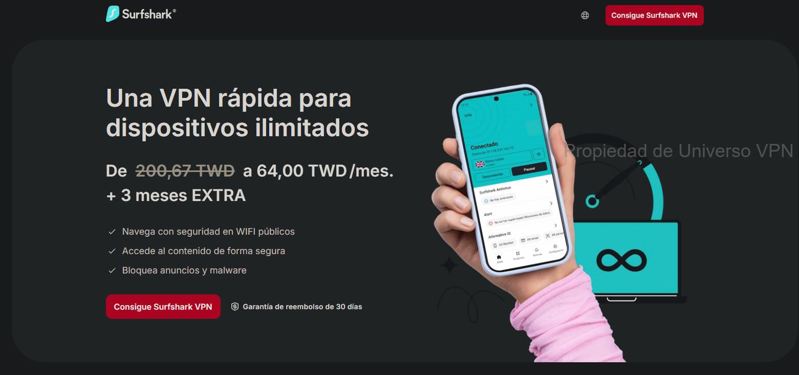

**Surfshark** is the household option in this comparison because it allows unlimited simultaneous device connections. Its lowest advertised monthly figure normally requires a long upfront term, so compare the full charge rather than the headline monthly rate. It is less compelling when only one or two devices need protection.

Surfshark publishes a large server network and provides apps for Windows, macOS, iOS, Android, and Linux, plus browser extensions and Smart DNS. Network totals and locations change, so use the official server list rather than an old count when a specific country matters.

Security includes AES-256-GCM encryption, WireGuard, OpenVPN, IKEv2, a kill switch, and a no-logs policy independently assessed by Deloitte. Surfshark is based in the Netherlands and says EU GDPR applies; check its current privacy policy and Trust Center for the exact data-handling terms.

Streaming compatibility changes as services update their detection systems. Surfshark is most compelling here when unlimited device connections matter; test each required streaming app during the refund window.

#### Surfshark Key Features

- Low advertised monthly pricing tied to a longer upfront term
- Published independent security and no-logs assessments
- Streaming support that must be checked on the required service and device
- Flexible payments: credit cards, PayPal, crypto, Amazon Pay, Google Pay
- Helpful 24/7 customer support
- 3,200+ servers in 65 countries with unlimited simultaneous connections
- **Unlimited devices** — cover your whole household (phones, laptops, TVs, etc.)
- Check the current refund or trial terms before paying
- Long-term promos are usually the lowest-price option; confirm the final USD total, tax, add-ons, and renewal before paying
- Surfshark Nexus (advanced features like IP Rotator for automatic IP changes every few minutes without disconnecting, plus more tools added over time)

### 4. [FlowVPN – 3-Day Trial](https://www.flowvpx.com/sign-up/?locale=en&special=FREETRIAL&r=35-890485.w_github)

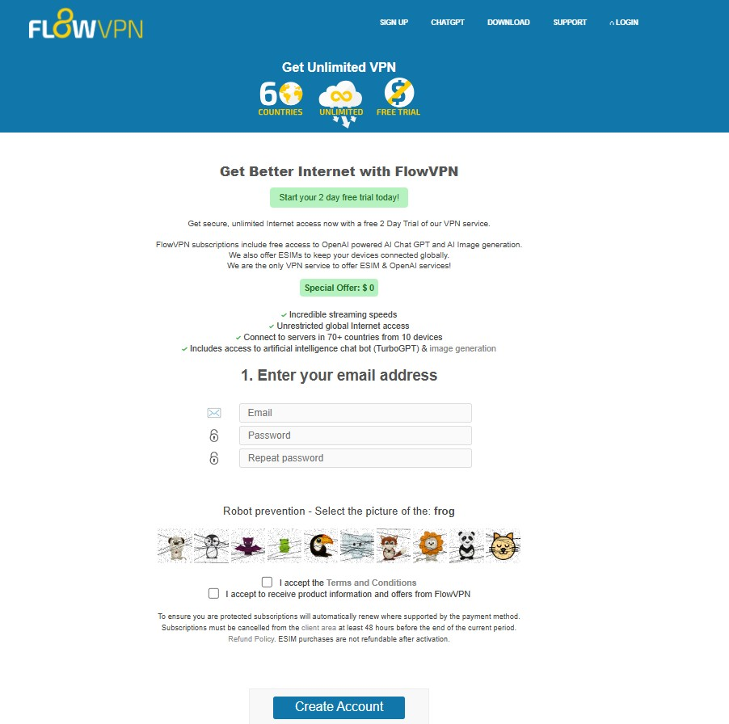

**FlowVPN** is included for its **three-day free trial**, which the current signup page says is activated through a PayPal pre-approved payment. Confirm trial eligibility, the post-trial charge, and the cancellation deadline before starting.

Use the project speed chart to compare FlowVPN under the same test framework as the other providers. Your own result can differ by network and server, so the trial is most useful when you can test immediately.

**July 2026 Windows app update:** FlowVPN says its new Windows app adds Split Tunnelling / VPN Bypass, new HTTPS or SMTP tunnelling protocols, and a cleaner interface. For Windows users, this makes FlowVPN more useful as a quick trial or backup VPN before committing to a long plan. It does not change our main buying logic: StrongVPN remains the clearer one-year value pick, while FlowVPN is best tested first with the short trial. See FlowVPN's Windows app note here: [FlowVPN Windows Application](https://www.flowvpn.com/windows-application/).

#### FlowVPN Key Features

- **3-day free trial** — use the published trial window for a focused compatibility test
- Confirm the PayPal authorization, post-trial charge, and cancellation deadline
- Compare its measured results with the other providers in the project charts
- Payment options and support availability should be confirmed on the live signup page
- Wide range of protocols: IPSec IKEv1/IKEv2, WireGuard, OpenVPN, L2TP, PPTP, plus custom SSL and FlowTCP
- Server availability in the locations you need should be checked in the current app or provider list
- Native apps for Windows, macOS, iOS, iPad, Android
- Confirm the current simultaneous-device limit before subscribing
- Special discounts for students and educators

### Privacy Snapshot Before Buying

When choosing a VPN, read the current privacy policy and look for evidence that supports its claims. Jurisdiction is one factor, but ownership, app security, audits, transparency reports, and the data required for accounts and billing also matter.

#### ExpressVPN
ExpressVPN is headquartered in the British Virgin Islands and publishes privacy and security audit material. Review the current policy and audit scope rather than treating the phrase "no logs" as a complete description of every piece of account or operational data.

#### StrongVPN
StrongVPN is based in the United States and states that it does not collect or log traffic while customers use the service. Read the current policy for the distinction between VPN traffic, account information, billing data, support records, and website analytics.

#### Surfshark
Surfshark is based in the Netherlands. Its Trust Center says Deloitte assessed its no-logs commitments in 2023 and 2025. Treat this as stronger evidence than a marketing slogan, while still reviewing the current privacy policy for account, billing, and short-lived connection data.

| Feature                          | ExpressVPN                     | StrongVPN                  | Surfshark                      |
|----------------------------------|--------------------------------|----------------------------|--------------------------------|
| Jurisdiction                     | British Virgin Islands         | United States              | Netherlands                    |
| Published position on VPN activity logs | Review current policy and audit scope | Review current privacy policy | Review current policy and assurance scope |
| Account and billing data         | Collected as described in policy | Collected as described in policy | Collected as described in policy |

**Bottom line**: ExpressVPN and Surfshark publish independent assessment material; StrongVPN's value case is the simpler one-year purchase. None of those facts replaces reading the latest policy or testing the app behavior you rely on.

## Step-by-Step Tutorials: Buying StrongVPN with International Payments & Setting Up ExpressVPN

## StrongVPN – Step-by-Step Guide with International Payments

Payment methods vary by country and can change. Confirm the available cards, PayPal option, currency, first charge, and renewal amount on the live checkout page.

### Step 1: Access Our Exclusive Deal
Use the deal page here: [StrongVPN](https://strongvpn.com/?tr_aid=60d96b5810e50&chan=w_github_en&data1=vpnuniverse&data2=title) → Click "Start Now" (see screenshot below).  

### Step 2: Fix Any Connection/Buying Issues
If the site will not load or checkout fails, disable another active VPN or proxy, try a different browser, and compare home Wi-Fi with a mobile hotspot. Do not buy a second VPN solely to open the checkout page; contact StrongVPN support if the problem continues.  
Before paying, confirm the final 1-year USD total, tax, renewal price, and account terms in checkout.  
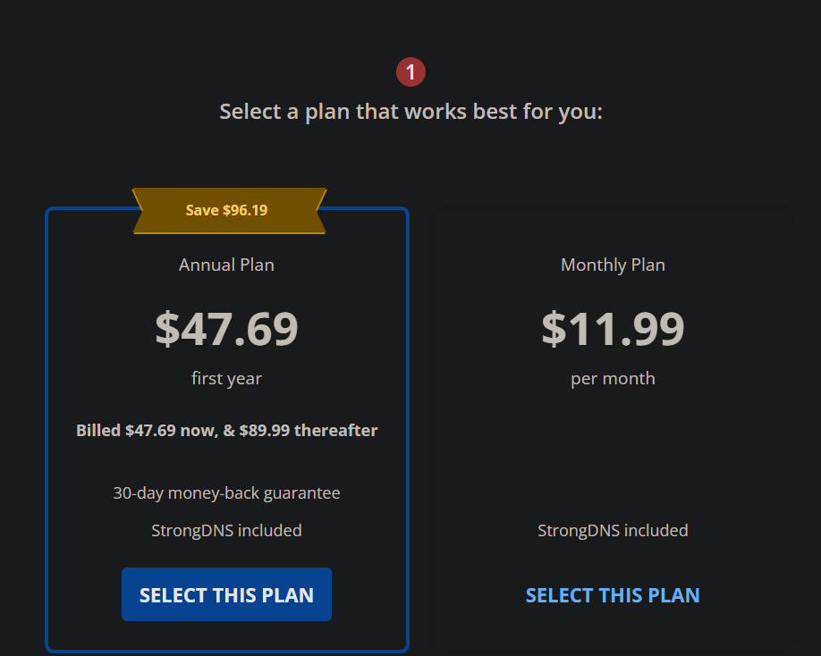

### Step 3: Choose Your Payment Method
Scroll to the payment section and use a method shown for your region. Confirm the currency, first charge, renewal amount, and refund terms before submitting payment.

### Step-by-Step Guide: Setting Up StrongVPN on Mobile Devices (Android & iOS)

StrongVPN provides Android and iOS apps. The exact prompts can change by app version, but the basic setup is similar on both platforms.

#### 1. Purchase & Create Your StrongVPN Account
Open the deal page: [StrongVPN](https://strongvpn.com/?tr_aid=60d96b5810e50&chan=w_github_en&data1=vpnuniverse&data2=title), pick your plan (1-year for best value), and sign up.

#### 2. Install & Connect on Android
- Open the Google Play Store and search for "StrongVPN".
- Tap "Install" to download the official app.
- Launch the app, enter your username and password, then hit "Log In".
- Tap "Best Available Location" for the fastest auto-connect, or choose a specific country/server manually.

#### 3. Install & Connect on iOS (iPhone/iPad)
- Open the App Store and search for "StrongVPN".
- Tap "Get" to download and install.
- Open the app, log in with your credentials.
- Select "Best Available Location" for automatic optimal connection, or pick a server from the list.

After connecting, verify the displayed server, public IP, and the apps you actually need. A connected status does not guarantee that every service will accept the server.

## ExpressVPN Purchase Guide – Check the Current Official Offer

ExpressVPN offers different payment methods by country and plan. Open the current official offer and verify the checkout total, payment method, tax, renewal, and refund terms before paying.

### Step 1: Open the ExpressVPN Offer
Click here: [ExpressVPN current offer](https://www.expressvpn.com/top/homepage?xvcid=yKMwqFWTfxyKWsB3AWwmhXdXUkpTX-RFKSOyxU0&shareid=&irclickid=yKMwqFWTfxyKWsB3AWwmhXdXUkpTX-RFKSOyxU0&irgwc=1&afsrc=1) → Hit "Get ExpressVPN" (look for the highlighted button in the screenshot).  
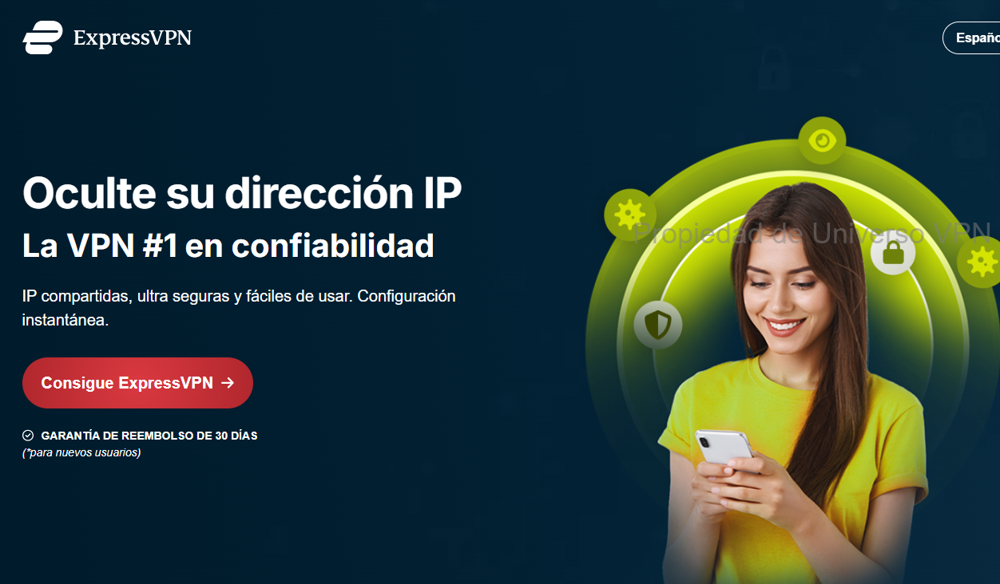

| What to Check | Why It Matters |
|---|---|
| Basic / Advanced / Pro tier | ExpressVPN features and device limits can vary by tier. |
| Final USD checkout total | The displayed monthly number may depend on plan length, tax, and campaign. |
| Refund or trial terms | Campaigns and plan tiers may change the usual terms. |
| Renewal price | The renewal price can differ from the first-term promotion. |

### Step 2: Confirm the Current Offer Before Paying
The offer page can change by campaign, country, device, and plan tier. Before paying, verify the final USD total, refund terms, renewal price, and whether the checkout page is showing Basic, Advanced, or Pro.  
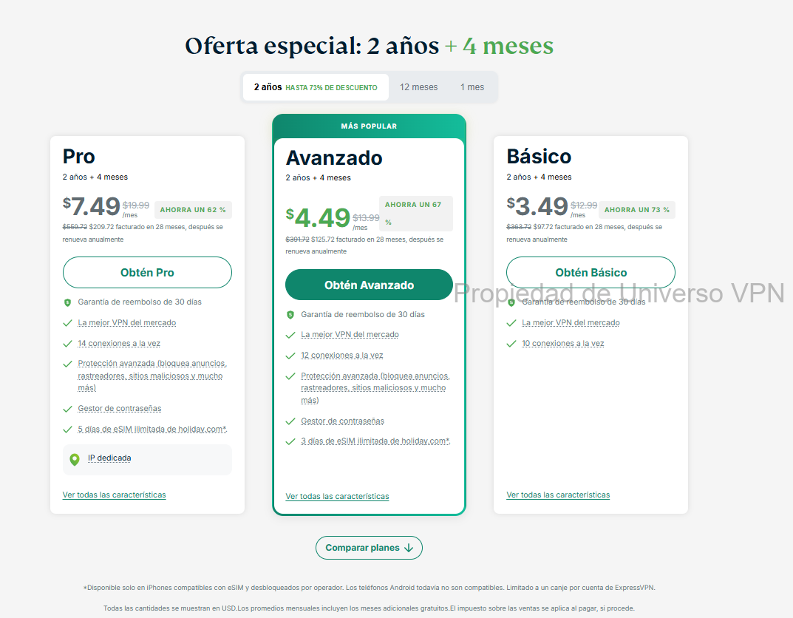

### Step 3: Enter Email & Payment Details
Use an email address you can access for account verification. Choose a payment method displayed at checkout and review the total and renewal terms before submitting.  
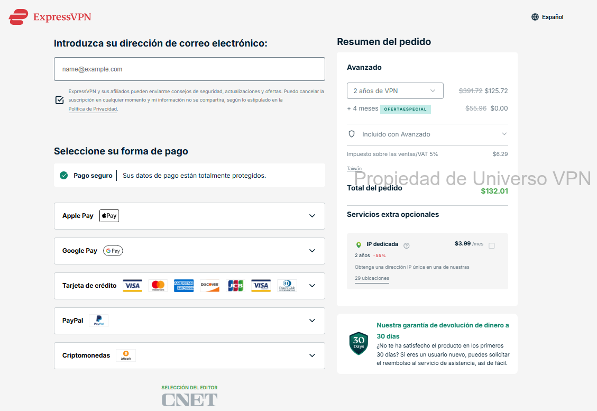

## ExpressVPN Setup Guide – PC, Mobile & Tablet

After creating an account, download the official app for each device and follow the current setup prompts.

#### 1. Purchase & Sign Up for ExpressVPN
Use our link: [ExpressVPN](https://www.expressvpn.com/top/homepage?xvcid=yKMwqFWTfxyKWsB3AWwmhXdXUkpTX-RFKSOyxU0&shareid=&irclickid=yKMwqFWTfxyKWsB3AWwmhXdXUkpTX-RFKSOyxU0&irgwc=1&afsrc=1), compare the current plan tiers, and create your account only after checking the full charge and renewal.

#### 2. Install & Connect on PC (Windows/macOS)
- Log in to the ExpressVPN website, download the app for your OS.
- Run the installer and follow the quick prompts.
- Open the app, log in, and connect with "Smart Location" (auto-picks the fastest) or choose any server manually.

#### 3. Install & Connect on Mobile (Android/iOS)
- From your phone, visit the ExpressVPN site (or search the app store), download the official app.
- Launch it, log in with your credentials.
- Hit "Smart Location" for instant best connection, or pick a country/server from the full list.

#### 4. Install & Connect on Tablet (iPad/Android Tablet)
- Same as mobile: Visit the site from your tablet, download the app (or grab from store).
- Log in, connect via "Smart Location" or manual selection.

Repeat the connection, IP, DNS, and app tests on each important device. Features and connection behavior can differ across platforms.  

(That covers the main paid VPN options, deal pages, and setup paths. Before buying, check the refund window, renewal price, supported devices, and the streaming services you actually use.)

## Step-by-Step Guide: Buying Surfshark & FlowVPN

## Surfshark – Quick Purchase Guide (Unlimited Devices Deal)

### Step 1: Open the Surfshark Long-Term Offer
Use the deal page: [Surfshark – Unlimited Connections](https://get.surfshark.net/aff_c?offer_id=323&aff_id=5585&source=w_github&aff_sub=en) → Hit "Get Surfshark" (see the button in the screenshot below).  

### Step 2: Check the Long-Term Plan Details
Long-term Surfshark plans are usually the cheapest monthly option, but the final price depends on campaign, taxes, add-ons, and renewal terms. Confirm the total USD charge and renewal price before paying.  
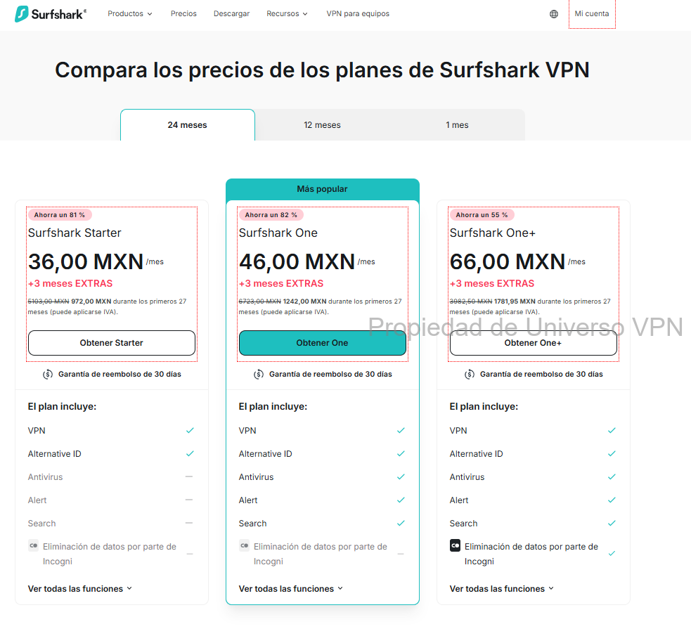

### Step 3: Enter Email & Complete Payment
Use an email address you can access, then select one of the methods currently displayed at checkout. Confirm the full initial charge, tax, add-ons, and renewal before submitting.  
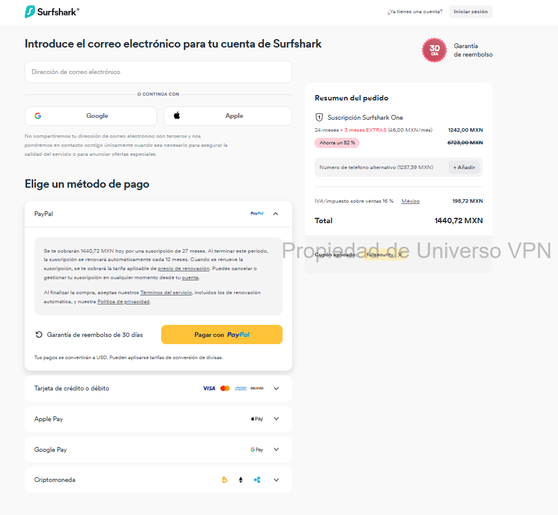

After signup, test the VPN on your real devices during the refund window: laptop, phone, TV, router, and the streaming apps you use most.

## FlowVPN – 3-Day Trial & Purchase Guide

FlowVPN is useful for a short compatibility test through its **three-day free trial**. The current signup page says the trial uses a PayPal pre-approved payment, so confirm the post-trial charge and cancellation deadline before activating it.

### Step 1: Start the Free Trial
Open our link: [FlowVPN – 3-Day Trial](https://www.flowvpx.com/sign-up/?locale=en&special=FREETRIAL&r=35-890485.w_github)  
Enter an email address you can access, create a password, and review the PayPal authorization before continuing.  
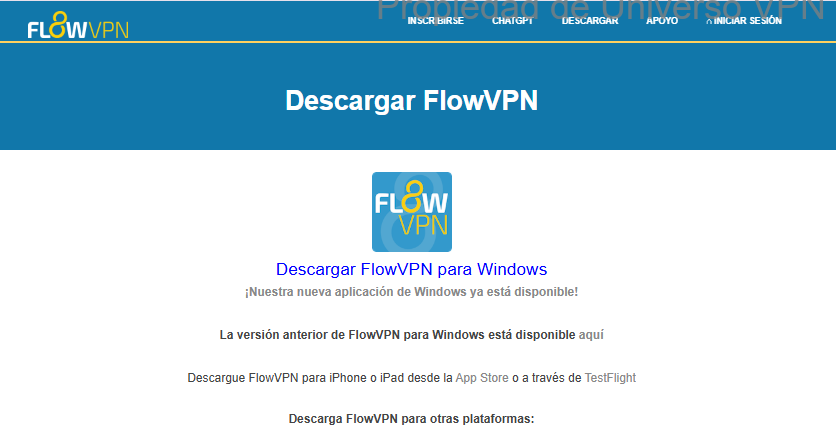

### Step 2: Complete Human Verification
Complete the verification challenge shown on the page. The exact prompt can change.  
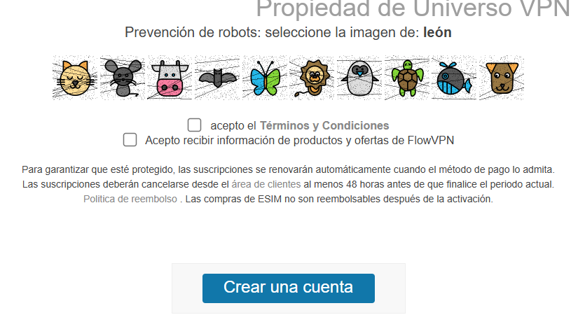

### Step 3: Download & Get Started
Once registered, head to the official download page: https://www.flowvpx.com/download/  
Choose the app for your device, install it from the official source, log in with your trial credentials, and test the network and apps you need.  

### FlowVPN trial checklist

- **3-day free trial** — use it immediately for the devices and network you need to verify
- PayPal pre-approved payment — confirm cancellation and post-trial billing before activation
- Compare the project speed results with your own connection
- Check support availability and payment terms for your region
- Wide protocols: IPSec IKEv1/IKEv2, WireGuard, OpenVPN, L2TP, PPTP, plus custom SSL & FlowTCP
- Check the current server list for the countries you need
- Apps for Windows, macOS, iOS, iPad, Android
- Confirm the current simultaneous-device limit before starting the trial
- Special student/educator discounts

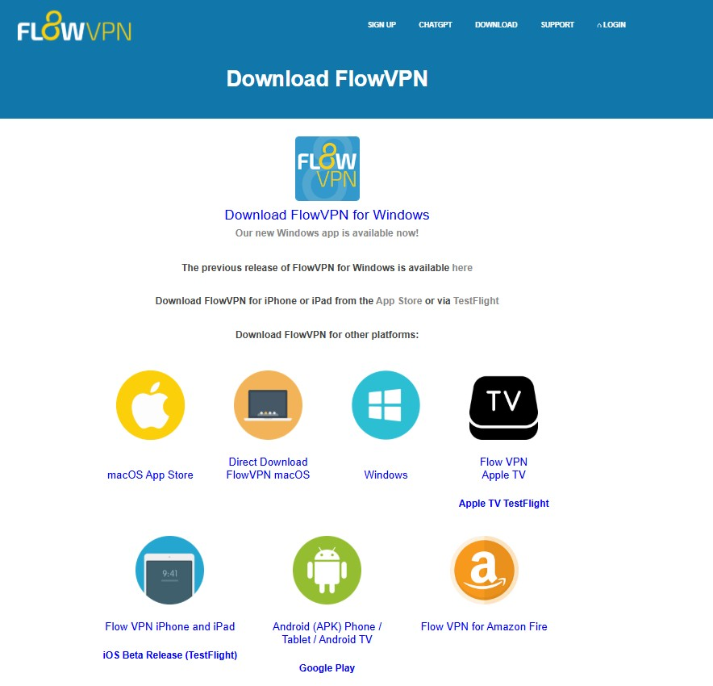

## VPN Connection Issues During Sensitive Periods & Pro Tips

In high-restriction or "sensitive" periods (e.g., political events, major updates, or regional crackdowns), some VPNs can experience temporary blocks or slowdowns. Here's how to stay connected:

- **Best Backup Options**: FlowVPN (with its custom protocols like FlowTCP & SSL) often works when others struggle — use the free trial to test during these times.
- **StrongVPN & Surfshark** usually recover fastest with frequent server refreshes.
- **ExpressVPN** is the premium fallback when app polish, support, and device coverage justify the higher total.
- **Pro Tips**:
  - Switch protocols (WireGuard first, then IKEv2/OpenVPN).
  - Try different servers (US/UK/Hong Kong often stay open longer).
  - Use obfuscation/camouflage modes if available.
  - Have 2–3 VPNs ready (e.g., Surfshark for daily, FlowVPN as emergency backup).
  - Download apps & configs **before** any restrictions tighten.

With these checks, you can compare price, device limits, refund terms, privacy policy, and streaming reliability without relying on hype.
### Detailed Privacy Evidence and Limitations

Privacy claims should be separated into provider statements and evidence that an outside party has assessed. Jurisdiction, policy language, audits, transparency reports, account data, and billing records all matter; none of them alone proves that every risk is absent.

#### ExpressVPN
Headquartered in the **British Virgin Islands** (zero mandatory data retention laws, outside Five/Nine/Fourteen Eyes alliances).  
ExpressVPN published a third KPMG assessment in 2025 covering TrustedServer and privacy-policy controls. This is independent evidence with a defined scope, not a promise that every product risk disappears.

#### StrongVPN
StrongVPN is based in the **United States**. Its policy says it does not log VPN activity, but this review did not find equivalent recent public audit evidence to the reports cited for ExpressVPN and Surfshark. Review the current policy for account, billing, support, and legal-request handling.

#### Surfshark
Based in the **Netherlands**, where Surfshark says EU GDPR applies.
Surfshark's Trust Center lists Deloitte no-logs assurance reports from 2023 and 2025. Review the current policy for account, billing, and temporary connection-data details.

| Feature                          | ExpressVPN                              | StrongVPN                           | Surfshark                               |
|----------------------------------|-----------------------------------------|-------------------------------------|-----------------------------------------|
| Jurisdiction                     | British Virgin Islands                  | United States                       | Netherlands                             |
| Evidence available               | KPMG 2025 assessment and Trust Center   | Provider policy; check current external evidence | Deloitte 2023/2025 reports       |
| Shares Data with Third Parties   | No, except valid legal order            | No, except valid legal order        | No, except valid legal order            |
| Independent evidence checked     | KPMG 2025                               | No equivalent recent public audit found in this review | Deloitte 2025                   |
| Transparency Reports             | Yes (regular)                           | No                                  | Yes (quarterly)                         |

**Purchase roles:**  
- Want the clearest **one-year value test**? Start with **StrongVPN**, then keep it only if it passes your real apps and network.
- Willing to pay more for **app polish and premium support**? Consider **ExpressVPN**.
- Need **unlimited device connections** and accept a longer commitment? Compare **Surfshark**.
- Need a **short compatibility trial** before a longer plan? Try **FlowVPN**.

Always double-check the latest policies directly on each site before committing, especially if you use the VPN for work, travel, or public Wi-Fi.

### VPN downloads and services to avoid

Avoiding a VPN should depend on verifiable warning signs, not an unsupported blacklist. Stop and investigate when you see any of the following:

- A “premium,” “activated,” or “pre-cracked” installer published by an unrelated GitHub account
- No identifiable operator, privacy policy, support contact, or current release history
- A public endpoint list with no explanation of who owns the servers or what is logged
- A binary release that cannot be matched to the project's official site, publisher, signature, or documented build process
- A lifetime plan with no credible explanation of how the network and support will be funded
- Checkout terms that hide the first charge, renewal, cancellation process, or refund conditions
- Security or privacy claims stated as fact without current documentation or independent evidence

A small or free project is not automatically unsafe, and a large paid provider is not automatically suitable. Verify ownership, releases, server responsibility, contract terms, and the exact device or service you need.

## VPN Recommendation Standards & Must-Have Features

### Key Criteria for Choosing a Reliable VPN

Use criteria that can be checked before purchase and tested before the refund window closes.

#### 1. Identifiable operator and maintained software
The provider or project should publish current apps, release notes, support contacts, privacy terms, and a clear explanation of who operates the servers. Company size alone does not prove quality, but abandoned software and anonymous infrastructure are avoidable risks.

#### 2. Personal Real-World Testing & Daily Use
The project compares daily speed checks, app behavior, streaming tests, refund terms, privacy documentation, and support routes. Use the charts as one input and repeat the important tests on your own network.

#### Essential Features Breakdown

1. **Full Cross-Platform Compatibility**  
   Confirm support for every device you will use. Windows and mobile apps are common; Linux, routers, Apple TV, Fire TV, and browser extensions vary by provider and plan.

2. **Simultaneous Device Connections**  
   - StrongVPN currently documents up to 12 simultaneous connections.  
   - Surfshark documents unlimited simultaneous connections.  
   - ExpressVPN limits can vary by plan tier, and FlowVPN limits should be checked on the live plan.  
   Installation limits and simultaneous-connection limits are not always the same.

3. **Split Tunneling (VPN Split Tunneling)**  
   Lets you route specific apps through the VPN while others use your normal connection. Example: Keep banking, work dashboards, or local apps outside the VPN while routing Netflix, Disney+, sports streams, or travel browsing through the VPN. That keeps everyday apps fast while still protecting the sessions that need it.

4. **Unlimited Bandwidth / No Data Caps**  
   Check for data caps or fair-use restrictions. “Unlimited” data does not guarantee that every server is uncongested or that the service never manages traffic.

5. **24/7 Live Chat Support**  
   Test the advertised support channel before the refund window closes, especially when a particular device or streaming service is essential.

6. **Refund / trial terms**  
   Check the official refund or trial policy before paying. Use that window to verify real-world performance in your region, then keep the plan only if it works.

#### Advanced Privacy & Security Features

7. **Strict No-Logs Policy**  
   The cornerstone of privacy: No recording of your activity, IPs, timestamps, or DNS queries. Hard to independently verify, so trust comes from jurisdiction, audits, and track record. We've already flagged providers caught logging/selling data — avoid them (see our "Avoid" list).

8. **Flexible Payment Options**  
   Credit/debit cards (Visa/MasterCard, including international), PayPal, Bitcoin, Google Pay, Amazon Pay — the more global options, the better for users worldwide.

9. **Modern encryption with documented implementation**  
   Look for maintained protocols, secure defaults, leak protection, and clear technical documentation. A large key-size number by itself does not prove that an app is implemented safely.

10. **Diverse Protocol Support**  
    WireGuard is often efficient, OpenVPN offers broad compatibility, and IKEv2 can reconnect well on mobile networks. Provider-specific protocols such as Lightway may also be useful. Avoid PPTP for sensitive traffic.

11. **Auto-Connect & Kill Switch**  
    Auto-connect on startup/Wi-Fi → never unprotected. **Kill Switch** (network lock) cuts internet instantly if VPN drops — non-negotiable for privacy.

These checks reduce avoidable risk, but no checklist guarantees that a provider will work on every network or service.

The order remains StrongVPN for a one-year value test, ExpressVPN when premium support and app polish justify the price, Surfshark for unlimited devices, and FlowVPN for a three-day compatibility trial.

Ready to compare? Use the links above, test during the refund period, and keep the VPN only if it works on your actual devices.

### VPN Server Analysis – Practical Tips & Insights

Server distribution is one of the biggest factors in real-world VPN performance. More servers = better, but **location**, **quality**, and **coverage** matter far more than raw numbers. The closer you are to a server (geographically), the lower your latency and the faster your speeds — simple physics.

#### How to Fix VPN Connection Drops & Interruptions

Drops can come from unstable Wi-Fi, a busy server, network switching, app problems, or regional restrictions. Work through these checks in order:

1. **Switch Servers Immediately**  
   Overloaded or flagged servers are common culprits. Jump to a nearby alternative (e.g., from New York to Chicago, or London to Manchester). Most apps have "Quick Connect" or "Best Location" for auto-picking the fastest stable one.

2. **Check & Stabilize Your Base Internet**  
   A VPN cannot fix bad Wi-Fi. Restart the router, switch to wired Ethernet if possible, and compare performance with the VPN off before changing providers.

3. **Change VPN Protocol**  
   Protocols affect stability:  
   - **WireGuard**: a good first choice for speed and modern app support  
   - **IKEv2**: useful on mobile because it reconnects quickly  
   - **OpenVPN UDP**: a broadly supported alternative  
   - **OpenVPN TCP**: sometimes useful on restrictive networks, although it may be slower  
   Avoid PPTP because its security is obsolete.

4. **Enable & Trust the Kill Switch / Network Lock**  
   A kill switch blocks selected traffic if the VPN drops. Behavior varies by app and operating system, so test it before relying on it.

**Pro Tip**: If drops persist, restart the app or device, clear the app cache where appropriate, or reinstall from the official source. If the issue remains, contact support before the refund window closes.

#### How to Keep Your VPN Always On & Reliable

If you need the VPN active whenever a device joins an untrusted network, configure and test the following:

1. **Pick a Truly Stable Provider**  
   Infrastructure, app maintenance, support response, and performance on your own network matter more than a broad stability claim.

2. **Enable Auto-Connect on Startup**  
   Set your app to connect automatically when your device boots or joins Wi-Fi/mobile data. (Available on all our recommended VPNs — check settings → General/Preferences.)

3. **Always Use Kill Switch**  
   Confirm which traffic the kill switch blocks and test it by interrupting the VPN connection.

4. **Monitor & Get Alerts**  
   Enable connection notifications where the app and operating system provide them.

5. **Keep Everything Updated**  
   Keep the operating system, VPN app, and router firmware current.

6. **Choose the Right Protocol for Your Scenario**  
   WireGuard for speed/stability, IKEv2 for mobile, OpenVPN TCP for very shaky connections.

Adapt these to your setup — you'll stay protected 24/7 with minimal hassle.

#### Physical vs. Virtual Servers – What You Need to Know
Physical servers = real hardware in the location advertised (best for speed & low latency).  
Virtual servers = software simulations hosted elsewhere (used when physical setup is impossible due to laws, costs, or restrictions).  
**ExpressVPN** uses some virtual locations transparently (e.g., Algeria, India) — you still get the advertised IP, but the actual hardware is in a nearby stable country. Speeds are usually excellent anyway.  
Most users won't notice — just know it's common among top providers for global coverage.

#### Streaming-Optimized (Multimedia) Servers
These are specially tuned for high-bandwidth tasks like Netflix, YouTube, Disney+, HBO Max. They handle massive traffic without throttling, and many use obfuscation to hide VPN usage — helping bypass streaming blocks.  
All our picks (especially ExpressVPN & Surfshark) have dedicated streaming servers — auto-selected or labeled in-app.

#### P2P / Torrent-Friendly Servers
Optimized for file sharing (torrents, direct downloads). They offer higher bandwidth, port forwarding (on some), and extra privacy layers.  
**Surfshark** and **StrongVPN** allow P2P on most/all servers. **ExpressVPN** supports it everywhere with excellent speeds.  
Always use these for torrenting to avoid ISP throttling or warnings.

**Bottom Line (2026)**: Server count alone is a weak buying signal. Focus on **location proximity**, **protocol flexibility**, official device support, the live contract, and whether the service passes your own refund-window check.  

Pick one, test these settings, and focus on stable speed, app reliability, and support response rather than marketing claims.

## Common VPN Problems and Practical Checks

Here are common VPN issues and a practical order for checking them. The cause can be the device, ISP, server, protocol, or destination service, so no troubleshooting sequence can promise a fixed success percentage.

### StrongVPN Suddenly Won't Connect – Quick Fixes
Connection failures can come from the local network, server, protocol, app version, account, or destination service.  
**Check in this order:**
1. **Switch Servers**: Use "Best Available" or try nearby ones (e.g., Japan → Singapore → Hong Kong for Asia users).
2. **Restart the connection path**: Restart the app first, then the device and router if the problem affects other traffic.
3. **Change protocol**: Try WireGuard, IKEv2, OpenVPN UDP, and OpenVPN TCP according to device support.
4. **Check official status and support**: Look for a current outage notice and provide the device, OS, error, network, server, and protocol when contacting support.

### "Suspicious Activity Detected – Contact Support" During StrongVPN Purchase
Fraud controls can react to public proxies, shared IPs, unusual locations, or account details.  
**Fixes**:
- Disable any active VPN/proxy before buying.
- Use clean home/mobile data (residential IP).
- Check that the email and payment details are accurate.
- If the message remains, contact support and share only the diagnostic information they request through the official channel.

### ExpressVPN stops connecting after a network change
A network update, blocked server, app issue, or protocol conflict can interrupt a connection.  
**Checks:**
1. **Server Hop**: "Smart Location" or try nearby (e.g., HK → Japan/Taiwan).
2. **Protocol Change**: Try Automatic or Lightway first, then another protocol supported on the device.
3. **App and network check**: Update the app and compare Wi-Fi with a mobile hotspot.
4. **Mobile Test**: Switch to phone data or another device.
5. **Support**: Ask for the current server and protocol guidance for your network.

### Surfshark Drops After Network Changes – Fix It Fast
Surfshark can also drop after Wi-Fi changes, sleep/wake, server congestion, or protocol conflicts.  
**Steps**:
1. **Update App**: Install the current official release.
2. **Enable Camouflage/NoBorders**: Settings > Advanced.
3. **Fastest Server**: Auto-connect or manual switch.
4. **Protocol**: WireGuard → OpenVPN UDP.
5. **Support**: Contact support with the device, OS, server, protocol, and error message.

### ExpressVPN Renewal Price – What to Check Before It Renews
ExpressVPN promotions and renewal terms can change by campaign and plan tier.  
**Renewal checklist:**
1. Check the renewal date and amount in the account dashboard.
2. Compare the current plan tiers and features with what you already use.
3. Contact support before renewal if the account page and original receipt disagree.
4. Cancel according to the published process if the renewal no longer makes sense.

Do not assume a new email makes you eligible for another introductory offer. Follow the provider's current eligibility rules.

### Local Sites Slow/Inaccessible After Connecting (ExpressVPN/StrongVPN)?
Global routing adds latency for local services (banking, local streaming).  
**Best Workarounds**:
1. **Split Tunneling** (Essential Feature):
   - ExpressVPN: Settings > Split Tunneling → Bypass local apps/sites.
   - StrongVPN: Settings > Advanced → Split for specific apps.
   Route only international traffic via VPN — locals stay fast.
2. **Use a nearby server**: A server in your own country often works better with local banking and media sites.
3. **Check DNS only when relevant**: Restore automatic DNS first; use a custom resolver only when the provider documents it for the problem.
4. **Review firewall or router settings carefully**: Do not open ports or change security settings unless the official support instructions require it.

If these checks fail, contact support before the refund window closes.  

You now have a practical setup checklist. Test speed, streaming, banking, work apps, and public Wi-Fi before keeping a long-term plan.

## Installation Guides for StrongVPN, ExpressVPN, Surfshark & FlowVPN

These step-by-step tutorials walk you through downloading, installing, and connecting on common devices. We use Windows/Mac examples, but the process is similar for Android/iOS/Linux — just download from the official app store or site. Some links are affiliate links; the practical test is whether the app works well on your real devices.

### StrongVPN Installation Tutorial
After purchasing via our link, log in to your account dashboard to download.

#### Step 1: Download from Official Site
Go to [StrongVPN](https://strongvpn.com/?tr_aid=60d96b5810e50&chan=w_github_en&data1=vpnuniverse&data2=title) (or your dashboard after signup). Click "StrongVPN Client" — it auto-detects your OS (Windows example here). Manually select if needed.  
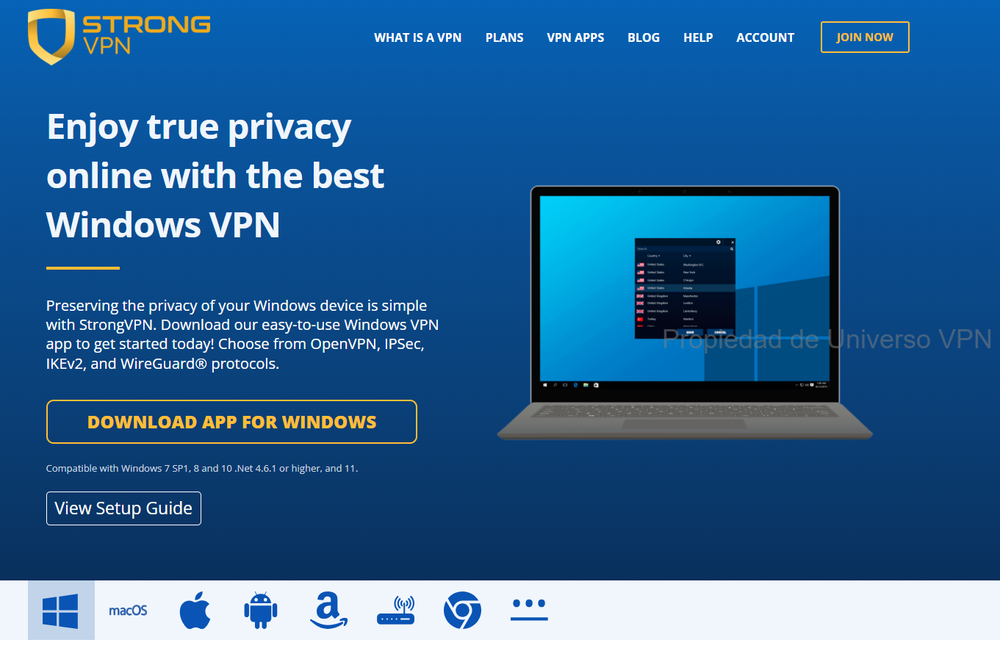

#### Step 2: Install the App
Run the downloaded file. Allow permissions when prompted (e.g., "Yes" to install network components). Confirm to launch on startup if asked.  
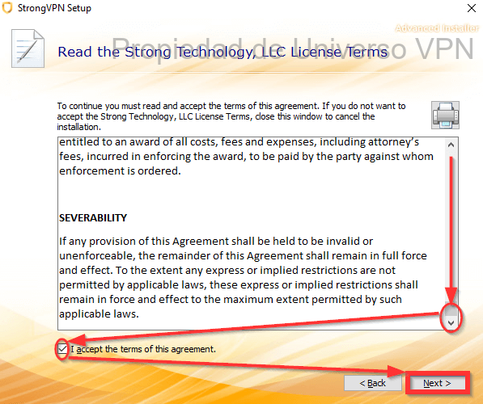

#### Step 3: Log In
Enter your email and password (sent during signup).  
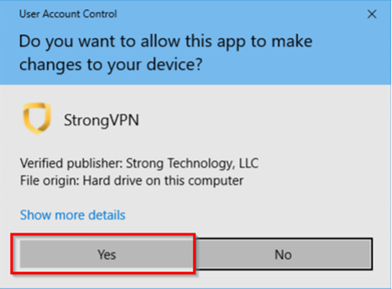

#### Step 4: Connect
Use "Best Available Location" for auto-fastest, or pick manually. Top stable picks from tests: UK, Japan, Australia, Singapore, US West. Click Connect — you're live!  
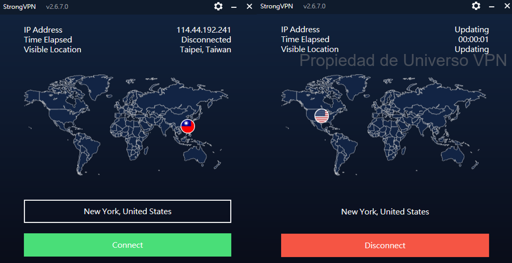

### ExpressVPN Installation Tutorial
ExpressVPN provides a guided setup flow on supported platforms.

#### Step 1: Buy & Get Activation Code
Use our deal link: [ExpressVPN Offer](https://www.expressvpn.com/top/homepage?xvcid=yKMwqFWTfxyKWsB3AWwmhXdXUkpTX-RFKSOyxU0&shareid=&irclickid=yKMwqFWTfxyKWsB3AWwmhXdXUkpTX-RFKSOyxU0&irgwc=1&afsrc=1) → Purchase → Log in to dashboard for your activation code. Download from [official Mac page](https://www.expressvpn.com/vpn-software/vpn-mac) (auto-detects). Mac example shown.  
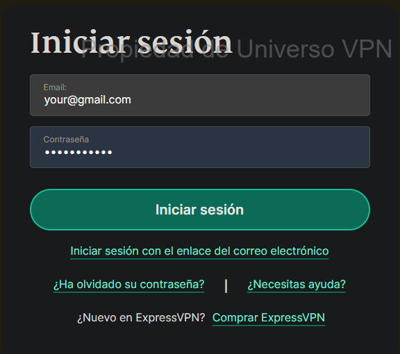

#### Step 2: Install
Open the .pkg file. Click "Continue" through prompts, choose install location, enter password if asked. Wait for completion.  
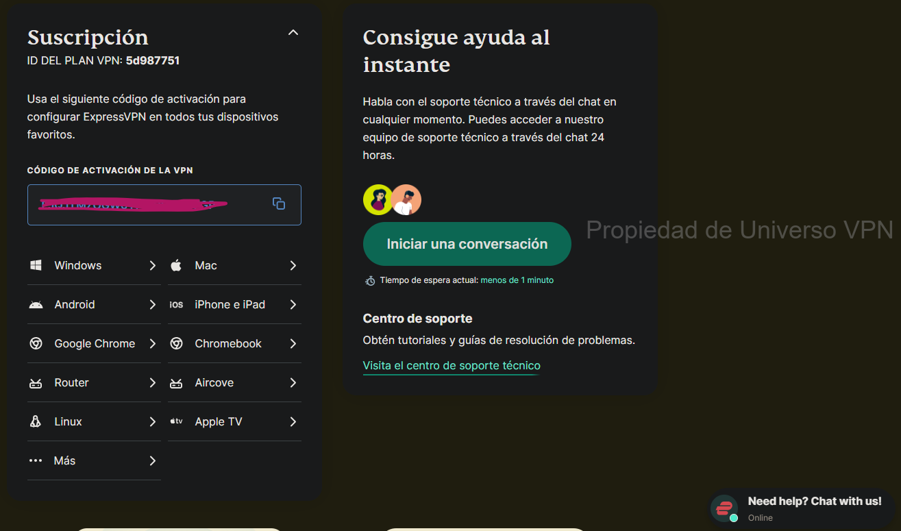

#### Step 3: Log In
Launch app → Sign in with email/password or paste activation code. Allow IKEv2 config when prompted (Mac security prompt).  
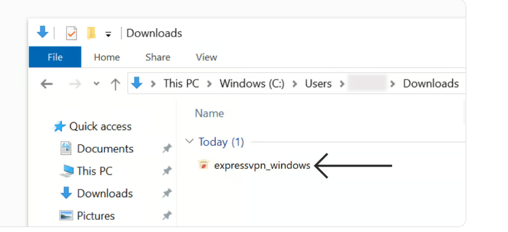  
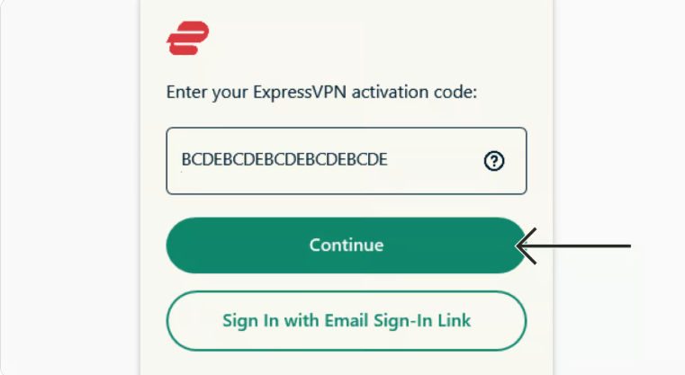

#### Step 4: Connect
Click the power button and use Smart Location or select the country you need. When connected, verify the server, public IP, and required apps. Device limits depend on the current plan tier.  
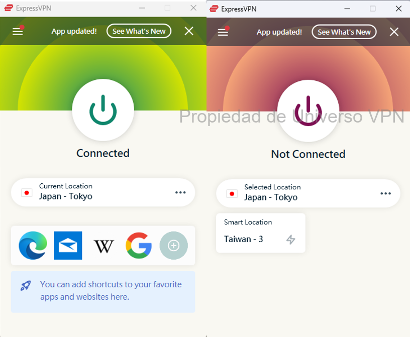

### Surfshark Installation Tutorial
Surfshark's main distinction in this comparison is unlimited simultaneous connections.

#### Step 1: Download & Install
After purchase, download from official site or dashboard. Run installer → Allow permissions at each prompt ("Yes").  
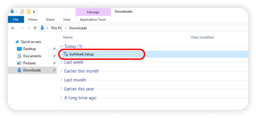  
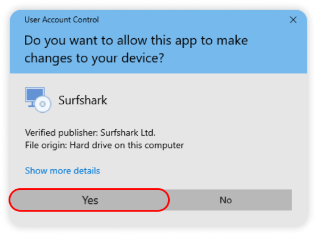

#### Step 2: Log In
Open app → Enter email & password from signup.  
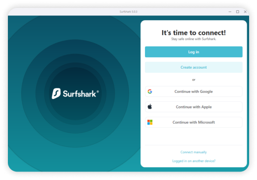

#### Step 3: Connect
Click "Quick-connect" or choose a location from the sidebar. After the status changes to connected, verify the public IP and the apps you need.  

### FlowVPN Installation Tutorial
Useful for a focused three-day trial test.

#### Step 1: Download
After signup/trial: Download from official site (Windows example).  
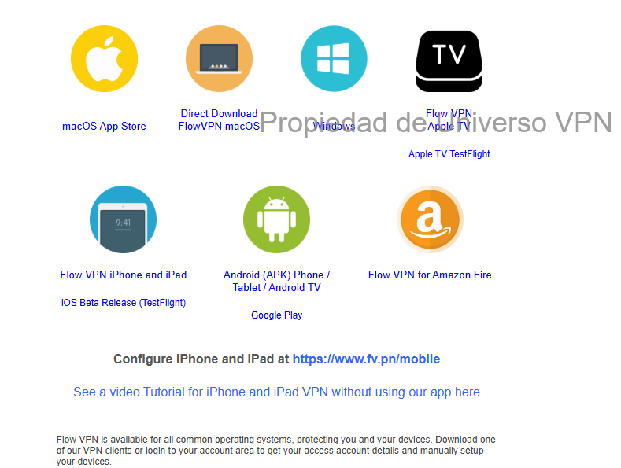

#### Step 2: Install & Connect
Run installer → Complete setup. Launch app → Log in with trial credentials. Click "Connect" → Choose country/server from menu. Shows "FlowVPN connected" when active.  
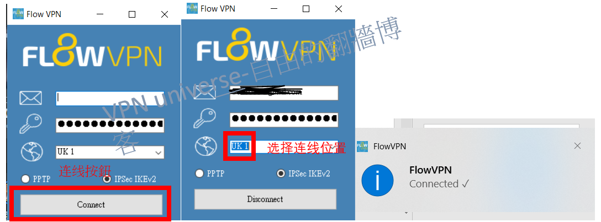

## What You Can Do with a VPN + Important Precautions

A VPN can encrypt traffic to its server, replace your public IP, and provide a consistent route on hotel, airport, campus, or shared Wi-Fi. It may help with travel and region-dependent services, but it does not guarantee access to every streaming library, prevent malware, hide account logins, or make prohibited activity lawful.

**Practical precautions:**
- Follow local law and the terms of the services you use.
- Use an identifiable operator for work, payments, primary accounts, and personal communications.
- Download apps from the official provider, app store, or verified project release page.
- Enable a kill switch when a dropped tunnel would expose traffic you intended to route through the VPN.
- Test streaming, banking, email, work tools, sleep/wake, and network switching before the refund window closes.
- Confirm renewal and cancellation terms instead of assuming an introductory discount will repeat.

Keep the VPN only if it behaves well in your real routine.

### Is Using a VPN to Bypass Restrictions Illegal?
In the US and Canada, using a VPN is generally legal and common for privacy, work, travel, streaming, gaming, and public Wi-Fi. Some services may still restrict VPN use in their own terms, especially streaming platforms, so test responsibly and follow the rules of the services you use.

The bigger issue: Authorities often block VPN websites/apps, making it hard to download one once you're already restricted.  
**Best Practice**: Install the VPN before you travel, test your main apps during the refund window, and keep support links handy in case a server stops working.  

**Important Note**: Never use a VPN for illegal activities. Stay within local laws to minimize any risk.

## Free VPN Risks and Accountable Alternatives

Free VPNs are not one category. An accountable provider with a documented free tier is different from an anonymous endpoint list, repackaged installer, or service with no identifiable operator.

Check these limits before using a free option:

- **Server responsibility:** Who operates the server and what connection data can it see?
- **Distribution:** Does the binary come from the official site, app store, or verified release page?
- **Business model:** How is the service funded, and does the privacy policy permit advertising or data sharing?
- **Practical limits:** Check country choice, device count, speed, queues, data caps, streaming support, and customer support.
- **Maintenance:** Look for recent releases, active maintainers, issue handling, and a way to report a security problem.

Proton VPN Free is included near the top as an accountable starting point with published limits. Unknown public servers should be reserved for disposable, low-risk testing, not payments, work, primary accounts, or private messages.

## Why Building Your Own VPN Is Not Recommended

Running your own WireGuard or OpenVPN server can be useful when you trust the hosting account and need a private route back to a known network. It is not the same product as a commercial VPN with many exit locations and support.

- **Technical Complexity**: You are responsible for server setup, keys, firewall rules, updates, monitoring, and recovery.
- **Maintenance Risk**: A self-hosted server can break, leak, slow down, or get flagged by streaming services unless you keep maintaining it.
- **Costs & effort**: VPS rental, bandwidth, backups, and maintenance can exceed the value of a basic commercial plan.
- **Poor Performance & Stability**: Single-server setups have no broad server network, no load balancing, limited device support, and weak streaming reliability compared with commercial VPNs.

**Verdict**: Self-hosting fits technical users who want control over one known route. A maintained commercial VPN is usually simpler when you need multiple locations, streaming tests, family devices, or customer support.

## Essential VPN Knowledge Everyone Should Understand

#### What Is the Core Principle of a VPN?
A VPN creates an encrypted tunnel between your device and the VPN server. Websites see the server's public IP, while the VPN operator still handles traffic after it leaves that server. A VPN does not automatically hide browser fingerprints such as language, screen size, fonts, cookies, or account identity.

#### What Are Geo-Restrictions and Network Checks?

Streaming platforms, apps, schools, workplaces, hotels, and public Wi-Fi networks can all apply different kinds of checks. Some are based on licensing, some on fraud prevention, some on security, and some on local network policy.

Common examples include:
- Streaming region checks
- Proxy or VPN IP detection
- School, workplace, or hotel Wi-Fi blocks
- Public Wi-Fi login portals
- Account security alerts when traveling
- DNS or location mismatch errors

A VPN is not magic, but a good provider gives you more server choices, encrypted traffic, and support when one route fails.

#### What Can a VPN Actually Do for You?
By routing through a remote server and changing your visible IP, a VPN can help with:

- **Streaming and travel checks**: Test how a service behaves from another server location, subject to its terms.
- **Network restrictions**: Reach services blocked by the local network where lawful.
- **Privacy from the local network**: Encrypt traffic to the VPN server and replace the public IP seen by destinations.
- **Public Wi-Fi**: Reduce what the local network can observe while retaining HTTPS and normal account security.
- **Remote Access**: Connect to work/school networks securely.

Use responsibly and legally — VPNs are tools for freedom and privacy, not for breaking laws.

You now have the core decision points: provider trust, app quality, device support, refund terms, speed, and support response.

#### Are VPNs Really Effective?
VPN usefulness depends on the provider and your use case. Good paid VPNs can help with public Wi-Fi privacy, travel, streaming reliability, remote work, and everyday security, but they still need to be tested on your own devices.

That said, skepticism is fair. Some "VPNs" have shady histories:
- Facebook's Onavo (Project Atlas) paid users $20/mo for root access and deep data collection — it was basically spyware disguised as a VPN.
- Hola VPN turned free users into an unwitting botnet (selling their bandwidth), fixed only after massive backlash.

**Quick Effectiveness Test**:
1. Connect to a server in another country.
2. Visit whatismyipaddress.com — your IP should change to the server's location.
3. Try accessing a blocked site (e.g., Google, YouTube, or Netflix US library).
4. Run ipleak.net or dnsleaktest.com — no leaks means it's working properly.

Passing these checks confirms the tunnel and basic leak behavior at that moment. It does not prove the provider's logging claims or guarantee future streaming access.

#### Do You Need a VPN in the US or Canada?

For most North American users, a VPN is not about censorship. It is about practical privacy, streaming reliability, travel, and safer connections on shared networks.

A VPN is most useful when you:
- Stream on hotel, airport, school, or apartment Wi-Fi.
- Want more privacy from ISP tracking and ad-tech profiling.
- Travel and need your usual apps, subscriptions, and accounts to behave consistently.
- Use public Wi-Fi for email, banking, work dashboards, or cloud tools.
- Want to test Netflix, Disney+, Hulu, Max, Prime Video, ESPN+, YouTube TV, or other services from a stable server location.

#### Where a VPN Helps Most for Everyday Users

- **Streaming**: Test nearby US or Canada servers first for Netflix, Disney+, Hulu, Max, Prime Video, ESPN+, and YouTube TV.
- **Public Wi-Fi**: Use a VPN at hotels, airports, cafes, coworking spaces, and schools.
- **Travel**: Reduce login friction when accounts see unfamiliar networks.
- **Remote work**: Add an encrypted layer when using dashboards, cloud files, email, and collaboration tools.
- **Households**: Choose a provider with apps for phones, laptops, Fire TV, Apple TV, routers, and smart TVs.

Bottom line: VPNs are not only for high-control networks. For this site, the main buyer intent is everyday privacy, streaming, travel, gaming, public Wi-Fi safety, and device support.

#### My Paid VPN Isn't Working – What to Do?
Paid VPNs fail less often, but when they do, follow this troubleshooting order (works for ExpressVPN, Surfshark, StrongVPN, etc.):

1. **Basic Checks & Restart**:
   - Verify username/password/activation code.
   - Restart device + router + VPN app.
   - Update the app to the latest version.

2. **Quick Fixes**:
   - Switch servers (try "Best/Fastest" or nearby countries).
   - Change protocol (WireGuard → IKEv2 → OpenVPN UDP/TCP).
   - Enable obfuscation/Camouflage/NoBorders mode if available.
   - Test on mobile data instead of Wi-Fi.

3. **Advanced Steps**:
   - Clear app cache (settings in app or device).
   - Reinstall the app.
   - Custom DNS: Try 8.8.8.8 + 8.8.4.4 (Google) or 1.1.1.1 (Cloudflare).

4. **Contact Support**:
   - Use 24/7 live chat (ExpressVPN/Surfshark/StrongVPN all have excellent ones).
   - Provide: device/OS, error message, what you've tried.
   - They often diagnose remotely, send custom configs, or refund if unfixable.

Most issues resolve in minutes with support. If it still fails, switch to your backup VPN (always have 2–3 installed).  

You now have enough context to pick a paid VPN, test it carefully, and keep only the option that works in your real environment.

## Advanced VPN Uses & Benefits

### Double or Multi-Hop VPNs – How & Why to Use Them

A double (or multi-hop) VPN routes your traffic through **two or more servers** instead of one — your connection goes: You → Server 1 → Server 2 → Internet. This adds an extra layer of protection, though it usually reduces speed a bit.

#### Key Advantages
1. **Stronger Privacy & Anonymity**  
   Your real IP is hidden behind the first server, so even if the second server is compromised or subpoenaed, it only sees the first server's IP — not yours. Makes tracing your activity extremely difficult.

2. **Extra Defense Against Surveillance & Leaks**  
   Ideal for high-risk scenarios: accessing sensitive data on public Wi-Fi (cafés, airports, hotels), journalism in monitored regions, or anyone paranoid about ISP/government logging. If one hop fails or is attacked, the second still shields you.

3. **Better at Bypassing Tough Censorship**  
   In places with aggressive filtering (e.g., Russia, Iran, or certain enterprise networks), chaining servers across different countries/jurisdictions can evade detection more reliably than a single hop.

**How to Set It Up**  
- **Built-in Multi-Hop**: Surfshark (MultiHop), ProtonVPN (Secure Core), NordVPN (Double VPN) — enable in app settings.  
- **Manual Chain**: Connect to one VPN (e.g., StrongVPN), then run a second (e.g., ExpressVPN) on top — works but more complex and slower.  
- **Best For**: Privacy extremists or users in heavily monitored areas.  
**Trade-Off**: Expect 10–30% speed drop due to double encryption & routing. Use only when privacy > performance.

### How VPNs Impact Internet Speed – Real Talk

VPNs add security, privacy, and global access — but they almost always slow things down a little. Here's exactly why, and how much to expect in 2026.

#### Main Reasons for Speed Loss
1. **Encryption Overhead**  
   Encrypting/decrypting every packet takes CPU power and adds tiny delays. Modern protocols like WireGuard minimize this (often <5–10% loss on good hardware), while older ones (OpenVPN) can hit 20–40%.

2. **Server Distance**  
   Physics rule: The farther the server, the higher latency and lower speed. Connecting to a server 10,000 km away adds ping and reduces throughput.  
   **Rule of Thumb**: Choose servers in your region or nearby — e.g., Taiwan → Japan/Singapore/Hong Kong for best speeds.

3. **Server Load & Quality**  
   Peak hours overload popular servers → slower speeds. Premium providers (ExpressVPN, Surfshark) invest in massive infrastructure and auto-optimize to the least loaded/fastest server.

4. **Your Base Connection**  
   VPN can't make your internet faster than it already is. If your ISP gives 100 Mbps but you have Wi-Fi interference or old router, VPN will highlight those issues more.

#### Realistic Expectations (2026 Tests)
- On 1 Gbps fiber + WireGuard + nearby server: 700–950 Mbps (5–30% loss, often unnoticeable for streaming/gaming).  
- Distant server or older protocol: 300–600 Mbps (still plenty for 4K Netflix, Zoom, downloads).  
- Multi-hop: 200–500 Mbps (usable but noticeable for heavy use).

**Tips to Minimize Speed Loss**  
- Use WireGuard or Lightway (ExpressVPN).  
- Pick "Fastest Server" or nearby locations.  
- Test with speedtest.net before/after connecting.  
- Avoid free/cheap VPNs — they throttle or cap heavily.  
- Upgrade router/modem if base speed is low.

Bottom line: With a good paid VPN and smart choices, speed loss is minimal — you get privacy and access without sacrificing everyday usability.

You're now set with advanced tips to get the most out of your VPN. Pick the right setup for your needs, test it out, and enjoy secure, unrestricted browsing.
**Conclusion**: Speed impact varies heavily by provider, protocol, server choice, and your base connection. Premium VPNs (ExpressVPN, Surfshark, StrongVPN) keep losses minimal — often 5–20% on good setups — while still delivering excellent privacy and access. Test with "Fastest Server" + WireGuard, and you'll barely notice the difference for 4K streaming, gaming, or downloads.

### VPN Apps vs. Proxy Tools

For North American users, a normal VPN app is usually the right choice. It protects the whole device, includes a kill switch, supports multiple platforms, and gives you customer support when streaming or public Wi-Fi fails.

Proxy tools and custom routing setups can be useful for technical users, but they usually require manual configuration and do not replace a full VPN app for streaming, travel, public Wi-Fi privacy, family devices, or remote work.

**Quick Summary**
- Want simple privacy, streaming, gaming, travel, and public Wi-Fi protection? Use a reputable paid VPN.
- Want custom routing for a special network setup? Proxy tools may help, but expect maintenance and less support.
- For most buyers, app quality, refund terms, server stability, and device support matter more than obscure protocol stacks.

## Advanced VPN Uses & Compatibility

### When It Makes Sense to Switch VPN Providers

Changing VPNs on a fixed schedule does not automatically improve privacy. Switch when the evidence changes: the provider no longer supports an app you need, performance becomes unreliable, renewal is poor value, a security incident changes your trust, or the exact streaming service you use stops working.

Before changing, compare the live renewal price, refund terms, device support, protocol options, and recent provider documentation. Test the replacement on your own network during its trial or refund window, then remove the old app and unused configuration profiles after you decide.

### FlowVPN for Apple TV

FlowVPN publishes Apple TV support, but app availability and installation steps can change. Check its current Apple TV documentation before subscribing rather than relying on an old TestFlight instruction. Its affiliate signup page currently advertises a three-day trial through PayPal pre-approved payment, so confirm the conversion charge and renewal terms before starting it.

For Apple TV, verify three things: whether the app is currently available in your App Store region, whether it supports the protocol and server location you need, and whether your exact streaming app works on your account. A working VPN connection does not guarantee that Netflix, Disney+, or another service will accept that server.

### Testing Netflix and Disney+ with a VPN

Streaming availability changes by account, device, server IP, and licensing region. Treat the charts later on this page as observations from the documented test setup, not as a promise that every regional library will work for every buyer.

Use this order when testing:
1. Install the official VPN app and connect to a nearby server in the required country.
2. Open the streaming app and test login, playback, subtitles, and video quality.
3. If it fails, try one other server or the provider's recommended protocol.
4. Contact support while you are still inside the refund or trial window.
5. Keep the plan only if the exact app, device, and network you use pass the test.

## Introduction to Common VPN Protocols & Tools

For everyday VPN buyers, protocols matter because they affect speed, battery life, stability, and streaming compatibility. You do not need to manage obscure proxy stacks to choose a good VPN. Start with the protocol options inside a reputable VPN app.

### WireGuard
WireGuard is usually the best starting point for speed, battery life, and modern device support. It is a strong choice for streaming, gaming, travel, and daily privacy.

### OpenVPN
OpenVPN is older but still trusted. It is useful when you need compatibility, manual router setup, or a fallback when a newer protocol has trouble on a specific network.

### IKEv2
IKEv2 can be useful on mobile devices because it reconnects quickly when switching between Wi-Fi and cellular data.

### Lightway and Provider-Specific Protocols
Some premium VPNs use their own protocols, such as ExpressVPN Lightway. These can be excellent if the provider maintains them well and supports your devices.

### Proxy Tools
Proxy tools and custom routing setups exist, but they are not the main recommendation for North American streaming, public Wi-Fi privacy, family devices, or normal remote work. They require more maintenance and usually do not replace a full VPN app with support, refunds, and device coverage.

**Bottom Line**: For most users, start with WireGuard or the provider's recommended automatic protocol. If streaming fails, switch servers first, then try another protocol, then contact support during the refund window.

### Differences & Use Cases: VPN vs. Tor

**VPN** (Virtual Private Network) and **Tor** (The Onion Router) serve different privacy needs.

#### 1. VPN: Encryption + Speed + Versatility
- **Encrypts the connection to the VPN server**: This helps protect traffic on local networks and prevents the ISP from seeing the destination of each connection, but the VPN provider becomes part of the trust model.
- **Hides your IP**: You appear at the VPN server's location.
- **May change apparent location**: Some services still detect or block VPN servers.
- **Trust factor**: Relies on the provider, so read its current privacy policy and independent audit information where available.
- **Speed**: Usually faster than Tor, although route and server load still matter.
- **Best for**: Everyday privacy, streaming, public Wi-Fi safety, remote access.

#### 2. Tor: Multi-Layer Routing
- **Multi-hop routing**: Traffic passes through volunteer relays so a single relay does not normally see both the source and final destination.
- **Different threat model**: Tor Browser is designed to reduce tracking and fingerprinting, but user behavior and device compromise can still reveal identity.
- **Dark web access**: Enables .onion sites.
- **Drawbacks**: It is slower and is not designed for high-bandwidth streaming or gaming. Use HTTPS because ordinary internet traffic leaves through an exit relay.

**When to Choose Which**  
- **VPN** for speed, streaming, gaming, general privacy, and handling geo-restrictions.  
- **Tor Browser** when its anti-tracking design and multi-hop routing fit your threat model, or when accessing onion services.  
Many users combine: VPN for daily use + Tor Browser for sensitive sessions.

Choose based on your threat model. Everyday public Wi-Fi protection and high-risk anonymity are different requirements, and a paid VPN is not a replacement for Tor in the latter case.

### VPN vs. Proxy Servers – Key Differences
VPNs and proxies route traffic differently and should not be treated as equivalent privacy tools.

#### 1. How They Work
- **VPN**: An operating-system VPN app normally tunnels traffic from the device to the VPN server and presents the server's IP to destinations.
- **Proxy**: Usually routes only the configured browser or app. Encryption depends on the proxy protocol and the application connection.

#### 2. Security & Privacy
- **VPN**: Useful on untrusted Wi-Fi because traffic to the VPN server is encrypted. It does not make unsafe websites, malware, or account practices harmless.
- **Proxy**: An unencrypted proxy offers no additional transport encryption. HTTPS still protects supported website connections.

#### 3. Speed & Performance
- **VPN**: Slight overhead from encryption, but premium providers (WireGuard protocol) keep it minimal — great for streaming/gaming.
- **Proxy**: Often faster (no encryption), but public proxies are overcrowded, unreliable, and risky.

**Bottom Line**: Choose a VPN when you need device-wide tunneling and a supported app. Use a proxy only when you understand its protocol, scope, and operator.

## Common VPN Protocols Explained

A VPN protocol controls how the encrypted connection is established. It affects speed, reconnection behavior, compatibility, and security, but it does not block every tracker or make an unsafe device secure.

- **PPTP**: Obsolete and weak. Avoid it for sensitive traffic.
- **L2TP/IPsec**: An older option that may still appear in manual setups, but modern apps usually offer better choices.
- **SSTP**: Mostly associated with Windows compatibility.
- **IKEv2/IPsec**: Reconnects quickly when a mobile device changes networks.
- **OpenVPN**: Mature, widely supported, and useful as a compatibility fallback.
- **WireGuard**: Modern, compact, and often fast. Many commercial providers use WireGuard or a modified implementation.

**Practical choice**: Start with the app's automatic setting or WireGuard. Try OpenVPN or another supported protocol when a particular network is unreliable.

## VPN Features for Gaming

A VPN can help when an ISP route is poor, a network filters game traffic, or you want to hide your home IP from other players. It usually adds an extra network hop, so it can also increase latency. No provider can promise lower ping for every game and location.

For gaming, compare **StrongVPN** first on price and **ExpressVPN** second when app or support quality matters. Latency depends primarily on route, server distance, congestion, and the game region.

### What to Test for Gaming
- **Latency**: Compare ping with the VPN off, with a nearby VPN server, and with a server near the game region.
- **Stability**: Watch for packet loss and disconnects across a real play session, not just one speed test.
- **Platform support**: Consoles may require a router or another supported setup because they do not all run VPN apps directly.
- **Account rules**: A VPN does not override a game's regional terms, store rules, or anti-cheat policies.

### StrongVPN and ExpressVPN for Gaming
- **StrongVPN**: Check first when a one-year price and WireGuard support matter. Test the exact game route during the refund window.
- **ExpressVPN**: Consider when its app, Lightway protocol, router support, or customer support justifies the higher total price.

Neither is automatically faster on every route. Keep the service only when it improves or preserves performance on the network and games you actually use.

- [Try StrongVPN Now](https://strongvpn.com/?tr_aid=60d96b5810e50&chan=w_github_en&data1=vpnuniverse&data2=title)
- [Try ExpressVPN Now](https://www.expressvpn.com/top/homepage?xvcid=yKMwqFWTfxyKWsB3AWwmhXdXUkpTX-RFKSOyxU0&shareid=&irclickid=yKMwqFWTfxyKWsB3AWwmhXdXUkpTX-RFKSOyxU0&irgwc=1&afsrc=1)

*Note: If you purchase through these links, we may earn a commission. Provider documentation, project comparison charts, and checks that require your own device are identified separately.*

Thanks for reading. Recheck the live checkout total and test the exact apps you need before the refund or trial period ends.

## Detailed VPN Speed Test Report (Fresh Daily Update – November 20, 2026)

### VPN Speed Tests Across Global Regions

The chart below shows real-world download (blue bars) and upload (red bars) speeds for our top four VPNs across major continents: Asia, Europe, North America, South America, Africa, and Oceania.  

**Important Note**: These are averaged from multiple daily tests (last 7–30 days, 10–20 connections/day). Actual results vary by your base internet speed, exact server location, time of day, network congestion, and ISP. Use as a reliable guide, not absolute guarantee.

### Connection Success Rates by Continent

This chart breaks down connection success rates (%) for ExpressVPN, FlowVPN, Surfshark, and StrongVPN across continents. Each sub-chart shows one provider, with continents on the x-axis and success % on the y-axis.

Key takeaways:
- **Asia, Europe, North America**: Extremely high stability — perfect for streaming, gaming (FIFA/EA FC), and daily use.
- **Africa & South America**: Lower averages due to local infrastructure challenges, but still usable with nearby servers.
- **Oceania & Central America**: Solid mid-range performance.

Overall: Choose based on your primary region — all four deliver excellent reliability where it matters most.

### Detailed Speed Breakdowns by VPN & Network Type

These tables show average speeds (Mbps) on different connections: 4G mobile, 5G mobile, and Wi-Fi (home/public). Tested on high-speed base lines for fair comparison — real results scale with your ISP.

#### StrongVPN Speeds by Network Type
StrongVPN shows a balanced profile in this sample; compare it with your own network because public Wi-Fi, server distance, and game routing can change the result.

| Region          | StrongVPN 4G (Mbps) | StrongVPN 5G (Mbps) | StrongVPN WiFi (Mbps) |
|-----------------|---------------------|---------------------|-----------------------|
| North America   | 60                  | 63                  | 60                    |
| Europe          | 78                  | 78                  | 77                    |
| Oceania         | 55                  | 58                  | 59                    |
| Asia            | 74                  | 72                  | 75                    |
| Central America | 48                  | 46                  | 48                    |
| South America   | 50                  | 51                  | 52                    |
| Africa          | 46                  | 46                  | 49                    |

#### ExpressVPN Speeds by Network Type
ExpressVPN delivers premium consistency — ideal for protecting privacy on café Wi-Fi while streaming or gaming smoothly.

| Region          | ExpressVPN 4G (Mbps) | ExpressVPN 5G (Mbps) | ExpressVPN WiFi (Mbps) |
|-----------------|-----------------------|-----------------------|-------------------------|
| North America   | 64                    | 62                    | 60                      |
| Europe          | 75                    | 79                    | 76                      |
| Oceania         | 58                    | 55                    | 56                      |
| Asia            | 75                    | 72                    | 72                      |
| Central America | 48                    | 49                    | 46                      |
| South America   | 51                    | 52                    | 54                      |
| Africa          | 48                    | 46                    | 48                      |

#### Surfshark Speeds by Network Type
Surfshark's unlimited-device policy is useful for larger households, but the chart does not guarantee lower gaming latency on every route.

| Region          | Surfshark 4G (Mbps) | Surfshark 5G (Mbps) | Surfshark WiFi (Mbps) |
|-----------------|---------------------|---------------------|-----------------------|
| North America   | 62                  | 64                  | 61                    |
| Europe          | 75                  | 76                  | 76                    |
| Oceania         | 55                  | 57                  | 58                    |
| Asia            | 76                  | 74                  | 75                    |
| Central America | 45                  | 45                  | 47                    |
| South America   | 54                  | 51                  | 53                    |
| Africa          | 46                  | 46                  | 45                    |

#### FlowVPN Speeds by Network Type
FlowVPN provides secure, reliable speeds — excellent for streaming on public Wi-Fi with its generous free trial.

| Region          | FlowVPN 4G (Mbps) | FlowVPN 5G (Mbps) | FlowVPN WiFi (Mbps) |
|-----------------|-------------------|-------------------|---------------------|
| North America   | 63                | 64                | 64                  |
| Europe          | 79                | 79                | 78                  |
| Oceania         | 56                | 58                | 57                  |
| Asia            | 74                | 76                | 72                  |
| Central America | 49                | 49                | 46                  |
| South America   | 53                | 54                | 51                  |
| Africa          | 49                | 45                | 48                  |

**Final Takeaway**: All four VPNs deliver strong real-world performance — ExpressVPN edges out for premium consistency, Surfshark for value/unlimited, StrongVPN for budget reliability, and FlowVPN for easy testing. Pick based on your region and use case (streaming, gaming, privacy). Results are fresh daily — test yourself and see the difference.

## VPN Success Rates for Connecting to Netflix & Disney+ (Jan 2026 Tests)

### Netflix Connection Success Rates by Continent

This chart shows the real-world success rate (%) of our top four VPNs (ExpressVPN, FlowVPN, Surfshark, StrongVPN) when connecting to Netflix libraries across continents. Each sub-chart represents one provider, with continents on the x-axis and success percentage on the y-axis.

Key highlights:
- **Asia, Europe, Oceania**: Near-perfect reliability — ideal for consistent streaming of US/UK/Japan libraries.
- **North America**: Extremely high across all providers.
- **Africa & South America**: Lower averages due to local network challenges and fewer optimized servers, but still workable with nearby options.

Choose based on your location — these rates are averaged from daily tests over the last 7–30 days.

### Disney+ Connection Success Rates by Continent

Similar breakdown for Disney+ — success % for accessing libraries worldwide.

Standouts:
- **Asia, Europe, Oceania**: Excellent stability — great for Marvel, Star Wars, or regional exclusives.
- **North America**: Top-tier performance.
- **Africa & South America**: More variable, influenced by infrastructure — try US/UK/EU servers for best results.

Select your VPN according to your primary region and streaming priorities.

## Step-by-Step Guide: Watching Global Streaming Content with a VPN

Picture this: you open Netflix, Disney+, Hulu, or YouTube TV while traveling and the app shows the wrong library, a proxy warning, or a location error. A good VPN can improve your odds, but you still need to test the service you actually use.

Here is a practical way to test streaming access with **StrongVPN** first and **ExpressVPN** second, while the purchase can still be refunded.

### Step 1: Pick the Right VPN for Streaming
Start with the plan that fits your budget and devices. Streaming access changes, so no provider should be treated as a permanent unblock guarantee.

- **[StrongVPN](https://strongvpn.com/?tr_aid=60d96b5810e50&chan=w_github_en&data1=vpnuniverse&data2=title)**: A practical one-year value option with simple apps. Confirm the current payment methods and total at checkout.
- **[ExpressVPN](https://www.expressvpn.com/top/homepage?xvcid=yKMwqFWTfxyKWsB3AWwmhXdXUkpTX-RFKSOyxU0&shareid=&irclickid=yKMwqFWTfxyKWsB3AWwmhXdXUkpTX-RFKSOyxU0&irgwc=1&afsrc=1)**: A higher-priced alternative when app quality, Lightway, router support, or support coverage matters more than the lowest one-year total.

  

### Step 2: Install & Set Up Your VPN
Installation time depends on the device. Use only the provider's official download or app-store listing.

1. **Sign Up**: Click one of the links above, then confirm the current checkout offer, renewal price, and refund or trial terms before paying.
2. **Download the App**: Get the client for your device (Windows, Mac, iOS, Android, or router for Apple TV/Fire TV).
3. **Log In**: Use your email/password (or activation code for ExpressVPN).
4. **Connect to the Right Server**: Pick a server in the country required by the service or content, then use the provider's recommended location if several are available.

### Step 3: Start Streaming
- Open Netflix/Disney+/Hulu/etc.
- Search for the title and start real playback rather than stopping at the catalog screen.
- Check resolution, buffering, subtitles, and whether the app keeps you logged in.
- If playback fails, try one other server or protocol and then contact support.

Use StrongVPN or ExpressVPN as a starting point, then keep the plan only when your actual streaming app, device, account, and network pass the test before the refund window closes.

## How Netflix & Hulu Detect & Block VPN Connections

Netflix, Hulu, and other platforms enforce regional licensing and account rules. Their exact detection systems are private, but these are common signals that can affect VPN access:

#### 1. IP Address Detection
Services can identify IP ranges associated with hosting providers or unusually high numbers of users. A flagged server may trigger a location or proxy error.

#### 2. Behavioral & IP Distribution Analysis
Account region, payment country, device location, DNS results, and repeated IP changes can conflict with the VPN server location.

#### 3. App and Network Signals
DNS results, device permissions, cached app state, and account behavior can disagree with the selected VPN location. A VPN can change the public IP, but it does not control every signal used by the service.

**What to do**  
Try a provider-recommended server, restart the app, confirm the account region, and test another supported protocol. If the exact service still fails, use the refund policy instead of assuming a longer subscription will fix it.

## VPN Installation Tutorial on Linux

### Linux vs. Windows VPN Experience – Key Differences

A VPN boosts security, privacy, and access on any OS, but Linux and Windows handle it differently.

#### User Experience
- **Windows**: Most providers offer polished GUI apps — one-click connect, kill switch, split tunneling, easy server lists. Beginner-friendly.
- **Linux**: Fewer native GUI clients — many rely on command-line (OpenVPN/WireGuard configs) or third-party tools. More control for experts, steeper learning curve for new users.

#### Security
- **Linux**: Security depends on the distribution, updates, packages, configuration, and user behavior. Open source alone does not make every installation safer.
- **Windows**: Broad commercial VPN support makes app installation easier, but the operating system and VPN app still need current security updates.

#### Compatibility & Support
- **Windows**: Broadest support — almost every VPN has a dedicated app.
- **Linux**: Strong support via OpenVPN/WireGuard configs (works with ExpressVPN, StrongVPN, Surfshark). Some offer GUI wrappers (e.g., ExpressVPN's official Linux app, Surfshark's CLI + GUI beta).

**Bottom Line**: Windows usually has the broadest commercial app support. Linux can offer more control, but confirm that the provider supports your distribution, kill switch requirements, and preferred protocol before paying.

#### Five-step Linux setup
1. Start with **StrongVPN** for value, then **ExpressVPN** if you want a more guided premium app; Surfshark fits many devices and FlowVPN fits a short trial.
2. Download the official Linux app or OpenVPN/WireGuard configuration files from your provider account.
3. Install the app or import the configuration, then allow Linux to create the VPN network interface.
4. Test WireGuard first for speed; switch to OpenVPN TCP when a hotel, campus, or office network blocks the connection.
5. Check your IP, DNS, and kill switch before using public Wi-Fi. For streaming errors, try another server in the same country first.

## Apps & Services That Can Block or Restrict VPNs

Some apps and services actively detect and limit VPN connections for reasons like copyright enforcement, fraud prevention, abuse detection, or quality control. Here's a breakdown of the most common ones:

1. **Streaming Platforms**  
   - **Netflix, Hulu, BBC iPlayer, Disney+**: May use IP reputation, account region, DNS, device location, and other checks to enforce licensing. A paid VPN can still fail, so switch servers, clear stale app state, review the account region, and use the refund policy when the required service does not work.

2. **Banks & Financial Services**  
   - Many banks flag VPN IPs as suspicious (potential fraud or location spoofing). May trigger extra verification, temporary locks, or require phone confirmation.  
   Workaround: Use split tunneling to exclude banking apps from VPN, or connect to a server in your real country.

3. **Gaming Platforms**  
   - **Steam, Epic Games Store, Riot Games, Ubisoft**: Detect VPNs to prevent cheating, region-hopping for cheaper prices, or server abuse. Can limit matchmaking or flag accounts.  
   Workaround: Choose low-ping nearby servers; avoid during ranked play if possible.

4. **Social Media & Other Services**  
   - **Facebook, Instagram, X/Twitter**: Frequent IP changes or unusual locations may trigger CAPTCHA, extra login verification, or temporary restrictions.  
   Workaround: Stick to one server/location consistently; use split tunneling for social apps.

**General Tips to Minimize Blocks**:
- Use streaming/P2P-optimized servers when available.
- Enable obfuscation/camouflage modes.
- Rotate servers sparingly (avoid rapid switching).
- Split tunnel apps that do not need the VPN, such as banking or local services, when needed.
- If blocked, contact support — premium VPNs often have dedicated fixes.

## BitTorrent with VPN – Setup & Best Practices

BitTorrent (and other P2P protocols) is great for fast file sharing, but it exposes your real IP to peers — risking legal notices, ISP throttling, or privacy leaks. A VPN hides your IP, encrypts traffic, and prevents throttling.

### Key Setup Tips
1. **Choose a P2P-Friendly VPN**  
   Not all allow torrenting (some block ports or log activity). Our top picks:  
   - **Surfshark** — P2P on all servers, unlimited devices, fast WireGuard.  
   - **StrongVPN** — Strong P2P support, 12 simultaneous connections.  
   - **ExpressVPN** — P2P allowed everywhere, excellent speeds & privacy.

2. **Always Enable Kill Switch**  
   If VPN drops, kill switch cuts internet — your real IP never leaks to torrent swarm. Essential!

3. **Encryption Level Balance**  
   High encryption = max security but slight speed hit. Use AES-256 (default on premium VPNs) or WireGuard (fastest + secure).

4. **Split Tunneling for Optimization**  
   Route only torrent client (qBittorrent, uTorrent, Transmission) through VPN — leave browsers/gaming on normal connection for max speed.

5. **Best Practices**  
   - Bind torrent client to VPN interface (prevents leaks if VPN fails).  
   - Use port forwarding if available (faster downloads).  
   - Avoid public trackers; stick to private ones.  
   - Test for leaks: Check ipleak.net with torrent active.

**Recommended order**: Start with **[StrongVPN](https://strongvpn.com/?tr_aid=60d96b5810e50&chan=w_github_en&data1=vpnuniverse&data2=title)** when the one-year total fits your budget. Consider **[ExpressVPN](https://www.expressvpn.com/top/homepage?xvcid=yKMwqFWTfxyKWsB3AWwmhXdXUkpTX-RFKSOyxU0&shareid=&irclickid=yKMwqFWTfxyKWsB3AWwmhXdXUkpTX-RFKSOyxU0&irgwc=1&afsrc=1)** when its app, support, or router features justify the higher price. Confirm the provider's current P2P policy and test binding and kill-switch behavior before transferring data.

## Common VPN Limitations & How to Solve Them

VPNs are powerful, but not perfect. Here are the main drawbacks and practical fixes:

1. **Speed Reduction**  
   - **Issue**: Encryption + routing adds overhead.  
   - **Fix**: Try WireGuard or the provider's recommended protocol, choose a nearby server, and compare against the same base connection.

2. **Connection Drops / Instability**  
   - **Issue**: Server overload, ISP interference, or network changes.  
   - **Fix**: Enable auto-reconnect and the kill switch, then test another server or protocol. Contact support before the refund window closes.

3. **Device/Platform Compatibility Issues**  
   - **Issue**: Some VPNs lack native apps for Linux, routers, smart TVs.  
   - **Fix**: Choose multi-platform providers (ExpressVPN, Surfshark, StrongVPN). Use OpenVPN/WireGuard configs for unsupported devices.

4. **Privacy Concerns (Logging, Jurisdiction)**  
   - **Issue**: Some providers log data or are in surveillance-heavy countries.  
   - **Fix**: Read the current privacy policy and recent audit or transparency material. Consider ownership, jurisdiction, app security, account data, and audit scope together.

5. **Streaming/Game Blocks**  
   - **Issue**: Services detect VPN IPs.  
   - **Fix**: Try a provider-recommended server or protocol and contact support. If the required service still fails, use the refund policy.

Test the limitations that matter to you during the refund period. Keep the subscription only when it works on your network, devices, and required services.
